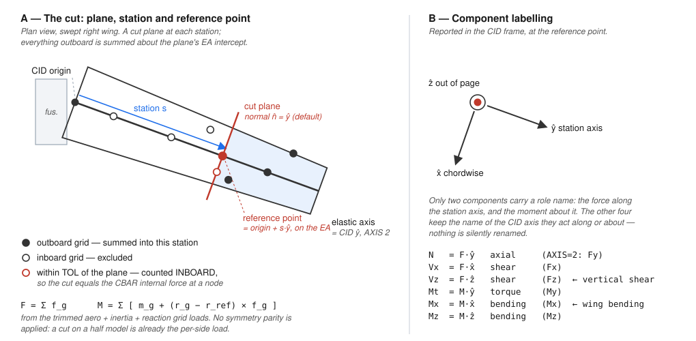

# sbeam — BDF Card Reference

All BDF cards supported in Phases 1–2 (structures), Phases A–C (aeroelastics, including splining and trim), and Phase G0 (transient maneuver loads). For each card: field layout, variable names and types, defaults, and a minimal example.

## Supported cards at a glance

Every card and case-control keyword sbeam reads; the sections below give each card's fields. Where sbeam differs from MSC NASTRAN or ZAERO, the difference is listed once in the [deviation register](12_deviation_register.md). Cards named by neither MSC nor ZAERO are listed with their nearest vendor card under [sbeam-only cards](#sbeam-only-cards). Gate: `tests/parser/test_unsupported_cards.py` asserts no card listed here is in the refused set (moved here from `CLAUDE.md`, 2026-10-25).

- **Structure:** CORD2R, GRID, CBAR, CROD, CONROD, PLOTEL, RBE3, RBE2, RBAR, CBUSH, PBAR, PROD,
  PBUSH, MAT1
- **Mass:** CONM2, MASSCASE, MASSSET (MSC)
- **Constraints/loads:** SPC, SPC1, FORCE, MOMENT, LOAD, GRAV
- **Eigenvalue:** EIGRL
- **Aero (Phase A/C):** AEROS, CAERO1, PAERO1, AEFACT, W2GJ, WKK, DMIJ (W2GJ), DMIK (WKK), AECORR, CPINJ,
  PSTRIP, STRIPK, SPLINE2, LOADINJ, BODYATT, SET1, AELIST, AESTAT, AESURF, TRIM, TRIMVAR,
  TRIMINEQ, TRIMWGT, SUPORT, DIVERG, MONPNT1, MONSECT, AECOMP, GUSTLF
- **Transient maneuver (G0):** MANVR, MANTRIM, MANCMD, MANTIME, MANPRNT, TABLED1
- **Case control:** SOL, SUBCASE, LOAD, SPC, METHOD, TRIM, MANVR, MASSCASE, GUSTLF,
  DISPLACEMENT, SPCFORCE, OLOAD, FORCE, STRESS, BEGIN BULK, ENDDATA

---

## File Structure

A sbeam run file (`.bdf`) has three sections:

```
$ comments begin with $
SOL 101               ← case control section (no header line)
SUBCASE 1
  ...
BEGIN BULK            ← marks start of bulk data section
  ...
ENDDATA               ← ends the bulk data (optional)
```

A bulk-only file (`.dat`) contains only the bulk data cards (no case control, no `BEGIN BULK` / `ENDDATA`).

The file is read as NASTRAN reads it (#81). Page numbers are PDF pages of the MSC Nastran
2024.1 Quick Reference Guide (QRG).

- **`INCLUDE 'file'` inserts the file's text where the statement stands**, anywhere in the
  input (QRG p.465, p.1984). A bulk data file is therefore INCLUDEd **below** `BEGIN BULK`
  (the QRG's own example, p.1984); a driver composes a shared bulk with an overlay by
  INCLUDEing both there (`sample/cessna210_flagship/cessna210_flagship_body.bdf`). A file INCLUDEd above
  `BEGIN BULK` is case control: a case-control fragment works, and a file holding bulk cards
  there is refused, naming the file. (The case-control INCLUDE page, p.465, captions its
  example "obtain the Bulk Data" with the INCLUDE above `BEGIN BULK`; the File Management
  and Bulk Data pages, p.131 and p.1984, place it below. sbeam follows the insertion rule.)
- **Filenames.** Quoted with `'` or `"`, or unquoted. A quoted name may run over several
  lines, which join with no separator (QRG p.1984 remark 2). A relative name is resolved
  against the directory of the file holding the `INCLUDE` — sbeam's rule; the QRG leaves
  filenames to the installation.
- **Nesting.** An INCLUDEd file may INCLUDE others, at most 10 deep (QRG p.1984 remark 1).
  Deeper nesting and a file that INCLUDEs itself are refused.
- **`ENDDATA` ends the bulk data** (QRG p.1808); it is optional. A card after it is refused
  rather than read or dropped, so a file INCLUDEd ahead of more bulk data must not end in
  `ENDDATA`. Comments and blank lines after it are harmless.
- **`BEGIN BULK`, and `BEGIN MASSID` sections.** `BEGIN [BULK] MASSID=n [LABEL=text]` opens
  an incremental mass section (QRG p.286–287), read to the next `BEGIN MASSID` or the end of
  the bulk data; see [MASSSET](#massset--msc-mass-combination-102) (#102). `BEGIN SUPER=n`
  (with or without MASSID), `BEGIN BULK TRMC=n`, `BEGIN AUXMODEL=n` and the other forms that
  open a separate Bulk Data Section are refused. A repeated plain `BEGIN BULK` is skipped.
- `CaseControl.includes` lists the files the main deck INCLUDEs below `BEGIN BULK`, in order.

---

## Format Rules

| Feature | Syntax |
|---------|--------|
| Free-field | Comma-separated fields: `GRID, 1, , 0.0, 0.0, 0.0` |
| Fixed-field | Standard NASTRAN 8-column fields (no commas) |
| Continuation | Next line starts with `+` or `*`, or has a blank first field (`,` first in free field) |
| Large field | `NAME*` with 16-column fields 2–5, then a `*` line with fields 6–9 (fixed or free) |
| Comment | `$` anywhere on a line — rest of line is ignored |
| Blank field | Leave empty between commas or use double comma: `GRID, 1, , 0.0` |

Free, small and large field are all supported. Continuation lines must immediately follow their parent card.

**Field layout (#64).** Every card is read in NASTRAN's 10-field layout whatever its input
format (QRG p.1048–1052): field 1 is the name or continuation marker, fields 2–9 hold data,
and field 10 never holds data. A free-field line with more than 8 data fields **runs on into
automatic continuations**, 8 fields per line: `SPC1,100,12456,1,2,3,4,5,6,7,8,9,10` is SPC1
with grids 1–6 on the first line and 7–10 on a continuation. A token in a row's field-10
position is a continuation marker only if it starts with `+` or `*` and is not a number
(`+L1`, `+`, `*G1`); otherwise it is data. A physical continuation line always starts a new
row. Refused: a continuation line with no card before it, and a card that switches from
large to small field mid-row (the QRG's examples do not settle where its fields land).
Cards whose field 9 is unused in NASTRAN keep it blank in free field too: a one-line CONM2
needs `, ,` before I11 (see CONM2).

**Every line is read or the card is refused (#63).** A card with data on a continuation
line that sbeam does not read is refused, naming the card and the line. Most cards read only
their first line (or one continuation); cards that take more say so in their section. Blank
continuation lines are harmless. Before #63 such lines were dropped without a message (LOAD
components past the second line, AESURF limits, EIGRL options, MSC's second MONPNT1 line).

**Vendor fields tables (#95).** Each MSC card's section ends with a table of the fields in
MSC's layout, sorted by what sbeam does with them (CLAUDE.md rule 7):

- **Read** — the value enters the model. A note in brackets gives a limit on the value.
- **Refused** — a non-blank value (or the value named) refuses the deck.
- **Ignored** — accepted with no effect, for the reason given.
- **Not checked** — data in a field MSC's layout leaves blank is accepted and dropped
  without a message. That is a defect (#109), listed so the tables hide nothing.

The tables are generated from `tests/docs/test_field_dispositions.py`, which also probes
the parser one field at a time and fails if it stops doing what a table says. `DMIJ`/`DMIK`
and `TRIMVAR` carry their own per-field tables; `SPLINE1` and `MONPNT3` are refused whole.

**Real number fields.** A NASTRAN data field is **8 characters wide**, in free field as well as
fixed field — MSC rounds a longer free-field real to 8 characters (`1.2345678+2` becomes
`123.4568`, QRG p.1048), and other readers may truncate it. sbeam's own reader keeps full
precision on input. Implicit-exponent reals (`1.44+9`,
`-2.31-4`, `1.5+03`) are accepted on read alongside ordinary Python float literals;
`parser/bdf_field.parse_real` is the single read-side implementation and
`parser/bdf_field.fmt_real8` the matching write side.

On the write side `fmt_real8` is used by the **load-card exports** (`FORCE`/`MOMENT` from
`results/load_export.py`; see `05c_sol144_maneuver.md` for the precision bound it implies), the
**authored-card writers** (`model/card_writers.py`), and the **aero-correction card export**
(`W2GJ`/`AECORR`/`STRIPK` from `aero/section_correction.py` / `aero/body_correction.py`, which
delegates to `card_writers.write_card` — DEF-M12, fixed 2026-08-02).

**Card order and cross-references (#51).** Bulk cards may appear in **any order**, as in
NASTRAN. The reader checks each card on its own as it reads it (field values, DOF strings,
duplicates within its card type). Every reference *between* cards is checked once all cards are
read (`parser/bulk_xref.py`). A reference to a card the deck does not define **refuses the
deck** with a `ValueError` naming the card, the field and the missing ID. Nothing is dropped
silently. Before #51 a FORCE or CONM2 on a missing grid was ignored and the run completed
without that load or mass. A non-zero CID must name a CORD2R. Structural references checked
after the read:

| Card | Field → must exist in |
|---|---|
| CORD2R | RID → CORD2R |
| GRID | CP, CD → CORD2R |
| CBAR | GA, GB → GRID; PID → PBAR |
| CROD | GA, GB → GRID; PID → PROD; the PROD's MID → MAT1 |
| CONROD | GA, GB → GRID; MID → MAT1 |
| CBUSH | GA, GB (if given) → GRID; PID → PBUSH |
| PLOTEL, RBAR | grids → GRID |
| RBE2 | GN and every GM → GRID |
| RBE3 | REFGRID and every Gi → GRID |
| PBAR, PROD | MID → MAT1, including properties no element uses |
| CONM2 | GID → GRID; CID → CORD2R |
| SPC, SPC1, SUPORT | every grid → GRID |
| FORCE, MOMENT | GID → GRID; CID → CORD2R |

The aero, spline, trim, monitor and maneuver-loads references are listed with each card below.
Names and IDs that must be unique **across** card types are also checked after the read:

- element EIDs across CBAR, CROD, CONROD and CBUSH;
- PIDs across PBAR and PROD, and across PAERO1 and PSTRIP;
- monitor names across MONPNT1 and MONSECT.

Every other ID-keyed card is unique within its own card type only, and a second card with
an ID already in use refuses the deck (#57); cards that share a SID by design (FORCE,
MOMENT, SPC, SPC1, SUPORT, TRIMINEQ) accumulate. CONM2 EIDs are their own space: MSC's
HA144A gives CONM2 100 and CBAR 100 the same EID. RBAR, RBE2, RBE3 and PLOTEL also keep
their own spaces. This is more lenient than the documented NASTRAN rule: the COSMIC
manual's CONM2, CRBAR, CRBE2 and CRBE3 entries all say "Each element identification
number must be unique with respect to all other element identification numbers"
(NASTRAN-93 `um/BULK.TXT`, #61). MSC does not enforce this for CONM2 (HA144A). sbeam
documents the rule but does not enforce it (decided 2026-11-15); give rigid elements
their own EIDs if a deck must also run in NASTRAN.

When a deck has several faults, the first one reported may depend on where the cards sit,
but the deck is refused either way.

---

## sbeam-only cards

sbeam reads MSC NASTRAN cards in MSC's layout and ZAERO cards in ZAERO's layout (#99). The
cards below are **sbeam's own**: no MSC or ZAERO card has their name, so a deck that uses
them is an sbeam deck and will not run in MSC or ZAERO (CLAUDE.md rule 7: a vendor card
name keeps the vendor layout; an sbeam extension takes a name no vendor defines). The
names were checked against the MSC 2024.1 QRG and the ZAERO 9.2 User's Manual. Converting
an sbeam deck for MSC is a job for a command-line tool outside the solver, not for these
cards (parked: `docs/30_future/02_parked.md`).

| sbeam card | What it does | Nearest vendor card, and why it is not used | Old name (refused since v0.4.1, #87) |
|---|---|---|---|
| `MANVR` | Transient maneuver driver (quasi-steady VLM, modal or direct) | ZAERO `MLOADS`: an aeroservoelastic state-space run on FLUTTER, MINSTAT, ASECONT and MLDSTAT cards sbeam does not have (ZAERO 9.2 UM PDF p.398) | `MLOADS` |
| `MANTRIM` | Maneuver initial condition: a TRIM SID and the freestream density | ZAERO `MLDTRIM`: carries the trim values itself and is referenced from MLDSTAT (p.396) | `MLDTRIM` |
| `MANTIME` | Integration window; output interval in seconds | ZAERO `MLDTIME`: field 6 is an integer skip factor (p.395) | `MLDTIME` |
| `MANCMD` | Pilot command time histories by trim label | ZAERO `MLDCOMD`: commands through EXTINP actuator IDs (p.383) | `MLDCOMD` |
| `MANPRNT` | ASCII time-history output request | ZAERO `MLDPRNT`: a file and format layout (p.384) | `MLDPRNT` |
| `CPINJ` | Injected per-box steady pressure (CFD / wind tunnel) | ZAERO `CHORDCP`: thickness Cp for ZTAIC (p.226) | `CHORDCP` |
| `LOADINJ` | Panels that do not move, with their loads sent to one grid | ZAERO `SPLINE0`: no load-transfer grid, panels named by PANLST (p.478) | `SPLINE0` |
| `BODYATT` | Panels rigidly attached to one grid | ZAERO `ATTACH`: the same intent, panels named by PANLST (p.207) | `ATTACH` |
| `TRIMWGT` | Weighted least-squares objective on trim variables | ZAERO `TRIMOBJ`: an objective on TRIMFNC trim functions (p.510) | `TRIMOBJ` |
| `TRIMINEQ` | Inequality bound on one trim variable | ZAERO `TRIMCON`: constraints on TRIMFNC trim functions (p.501) | `TRIMCON` |
| `MASSCASE` | Payload / mass case with label, scale and operations | MSC `MASSSET` (also read, #102) | — (renamed from `MASSSET`, #78) |
| `GUSTLF` | FAR/CS 23.341 quasi-static gust case on a TRIM | MSC `GUST` is a SOL 146 dynamic gust | — |
| `MONSECT` | Section-cut running loads | MSC `MONPNT1` gives one point, not a cut | — |
| `PSTRIP`, `STRIPK` | Decoupled strip body panels and their slopes | MSC `PAERO2` slender bodies | — |
| `AECORR` | Force/pressure AIC correction to a target | MSC `WKK`/`FA2J` matrices via DMI | — |
| `MODEXP` (case control) | Reduced modal model export (OP4 + Universal file) for sgear and Flaps | MSC writes such matrices by DMAP `OUTPUT4` / `PARAM,EXTOUT`, not by one command | — |
| `W2GJ`, `WKK` | Baseline downwash and diagonal AIC weights as cards | MSC enters the same data as matrices named W2GJ and WKK: `DMIJ`/`DMIK` (read, #104 — [DMIJ / DMIK](#dmij--dmik--msc-aero-correction-matrices-w2gj-wkk)) or `DMI` (refused) | — |

`TRIMVAR` is not in this table: it is ZAERO's card and is read in ZAERO's layout (#87).

---

## Case Control Keywords

Case control appears between the `SOL` line and `BEGIN BULK`. `SUBCASE` groups the lines that follow it; the rules for lines outside a subcase are (#79):

- **Defaults above the first `SUBCASE`.** A selector (`LOAD`, `SPC`, `METHOD`, `TRIM`, `TRIMWGT`, `DIVERG`, `MANVR`, `GUSTLF`, `MASSCASE`) or output request above the first `SUBCASE` applies to every subcase. The same keyword inside a subcase overrides it for that subcase only. MSC: such requests "apply to all the subcases until they are cancelled" (AAUG 2023.1, PDF p.752).
- **`= NONE` cancels an output request**, so a subcase can switch a default off (`DISPLACEMENT = NONE`). Any other value turns the request on.
- **No `SUBCASE`.** The commands run as one subcase. sbeam numbers it 1; that number is sbeam's choice, not a cited MSC rule. The deck shape is MSC's own (QRG 2024.1, PDF p.465, INCLUDE example).
- **Nothing to run.** A deck with no `SUBCASE`, no selector and no output request still parses, so it can be read for its bulk data. The `sbeam` command refuses to run it and writes no f06.
- **`SUBCASE` IDs** are positive integers, each greater than every earlier one (QRG 2024.1, PDF p.651, SUBCASE remark 1). A repeated or descending ID is refused.
- **`TITLE`, `SUBTITLE`, `LABEL`** (#90). Under a `SUBCASE` each is that subcase's page heading. Above every `SUBCASE`, `TITLE` and `SUBTITLE` head every subcase that gives none (QRG p.679, p.658 remarks 1–2), while `LABEL` heads only output that is not tied to a subcase — the GPWG block (p.471 remark 2). An absent `SUBTITLE` or `LABEL` prints no line.

Every line above `BEGIN BULK` must be a command in the tables below; any other line is refused (#80). Page numbers are PDF pages of the MSC Nastran 2024.1 Quick Reference Guide (QRG).

- **Line format.** The command name ends at the first blank, `=`, `,` or `(`. A line ending in a comma continues on the next line (QRG p.209); `TITLE`, `SUBTITLE` and `LABEL` are never continued, which is sbeam's choice (*unverified* against MSC).
- **Abbreviations.** A command may be shortened to its first four or more characters when that is unique (QRG p.209): `DISP`, `SPCF`, `METH`, `SUBT`. Uniqueness is checked against the commands in these tables, not MSC's full list. `SUBC` is refused as ambiguous (`SUBCASE`, `SUBCOM`).
- **Describers.** A selector or output request with describers in parentheses (`DISPLACEMENT(PRINT,PUNCH) = ALL`) is refused; #85 will decide which describers are read.
- **`CEND`** is accepted and not required (it is optional in MSC too: QRG 2024.1 PDF p.150, remark 1). sbeam does not separate the executive section from case control.

| Keyword | Type | Description |
|---------|------|-------------|
| `SOL` | int or name | Solution type. `101` = static, `103` = normal modes, `144` = static aeroelastic trim. MSC's names `SESTATIC`, `SEMODES` and `AESTAT` are read as 101, 103 and 144 (QRG p.186–187); any other solution is refused |
| `TITLE` | str | First page-heading line of the `.f06` (QRG p.679) |
| `SUBTITLE` | str | Second heading line (QRG p.658) |
| `LABEL` | str | Third heading line (QRG p.471) |
| `SUBCASE` | int | Opens a subcase block, starting from the defaults above the first `SUBCASE`; all lines until the next `SUBCASE` belong to it. The ID must be greater than every earlier one |
| `LOAD` | int | Load set ID (references `FORCE`/`MOMENT`/`LOAD` bulk cards) |
| `SPC` | int | Constraint set ID (references `SPC`/`SPC1` bulk cards) |
| `METHOD` | int | Eigenvalue method SID (references `EIGRL` bulk card; SOL 103 only) |
| `TRIM` | int | Trim condition SID (references `TRIM` bulk card; SOL 144 only) |
| `TRIMWGT` | int | Trim objective SID (references `TRIMWGT` bulk card; over-determined SOL 144 trim) |
| `DIVERG` | int | Divergence condition SID (references `DIVERG` bulk card; SOL 144 only) |
| `MANVR` | int | Transient maneuver-loads SID (references `MANVR` bulk card; runs the Step 63 free-flight modal solver `solver/maneuver_modal.py` when the card's NMODES/METHOD/ZETA select it, else the prescribed-rigid direct solver `solver/maneuver_qs.py`; SOL 144, Phase G0) |
| `GUSTLF` | int | Gust load-factor case SID (references `GUSTLF` bulk card; FAR/CS 23.341 gust case run as a SOL 144 trim; sbeam extension) |
| `SET` | list | `SET n = i1, i2, i3 THRU i4 EXCEPT i5 …` or `SET n = ALL` (QRG p.625; #100). Integer lists only, used by `MODEXP`; a SET under a `SUBCASE` is that subcase's. EXCEPT drops numbers inside the preceding THRU range; numbers outside it are members (remark 3). Real, `101/T1` and literal forms are refused. A SET may be redefined |
| `MODEXP` | int | **sbeam-only command** (#100): `MODEXP(OP4,UF) = n` writes the reduced modal model of a SOL 103 subcase at the grids of SET n — `<deck>.op4` (MHH, KHH, PHIA, PHIX), `<deck>_dofmap.csv`, `<deck>.uf`; schema in `10_export_schemas.md` §7. Describers `OP4`, `UF` choose the files (both when none). Refused outside SOL 103, with EIGRL NORM = MAX, or naming no SET |
| `MASSCASE` | int | Payload / mass case SID (references `MASSCASE` bulk card, Step 60); the subcase runs at the resolved mass configuration — baseline when absent |
| `MASSSET` | int | MSC mass combination ID (references an MSC `MASSSET` bulk entry; QRG p.482; #102). One of `MASSCASE`/`MASSSET` per subcase; each must select its own kind of card. `MASS` is not a usable abbreviation |
| `DISPLACEMENT` | — | Accepted; displacements are **always printed** whatever its value (`= NONE` included). sbeam reads the request but no output depends on it (#91) |
| `SPCFORCES` | — | Accepted; SPC reactions are **always printed** (#91). MSC's full name, QRG p.634; `SPCFORCE` and `SPCF` are abbreviations |
| `OLOAD` | — | Request applied load echo output (SOL 101; printed only when requested; `= NONE` cancels) |
| `FORCE` | — | Accepted; CBAR/CBUSH element forces are **always printed** (#91). `ELFORCE` is equivalent (QRG p.413) |
| `STRESS` | — | Accepted; CBAR stresses at recovery points are **always printed** (#91). `ELSTRESS` is equivalent (QRG p.646) |
| `AEROF` | — | Request per-box aerodynamic force output (SOL 144; printed only when requested; emits the AERODYNAMIC BOX PRESSURES AND FORCES block) |
| `APRESSURE` | — | Request per-box aerodynamic pressure (ΔCp) output (SOL 144; same output block as `AEROF`). Usually written `APRES` (QRG p.263) |
| `INCLUDE` | str | Inserts a file where it stands (see File Structure). Above `BEGIN BULK` it may bring in case control; a bulk data file is INCLUDEd below `BEGIN BULK` (#81) |
| `PARAM` | — | `PARAM,name,value` (QRG p.570). Follows the bulk `PARAM` rules: the same refusals (`WTMASS`, `AUNITS`, `COUPMASS`, `INREL`, `G`, `W3`, `W4`, `LMODES`) and the same warnings for a PARAM sbeam does not read |

**Accepted and ignored** (no message; none changes a result):

| Command | Why it is ignored |
|---------|-------------------|
| `ID`, `TIME`, `DIAG`, `CEND`, `NASTRAN` | Executive statements with no effect on sbeam's results |
| `ASSIGN` | File assignment; sbeam names its own output files |
| `ECHO`, `ECHOON`, `ECHOOFF` | Listing control |
| `LINE`, `MAXLINES` | Page length and output line limit |
| `MONITOR` | sbeam prints monitor results in every run that defines monitor points. MSC itself ignores `MONITOR` in SOL 144 (QRG p.524 remark 2) |

**Accepted with a warning** (the output is not written): `GPFORCE` (QRG p.434), `TRIMF` (QRG p.683; its describers, SET and rigid load sets are #105).

**Refused by name:**

| Command | Reason |
|---------|--------|
| `AESYMXZ`, `AESYMXY` | In MSC these decide the aerodynamic symmetry when present (QRG p.252 remark 1, p.251). sbeam reads the symmetry from `AEROS` only, so the command is refused instead of dropped |
| `SUBCOM`, `SYMCOM`, `SYM`, `REPCASE` | Subcase delimiters other than `SUBCASE` (QRG p.210). Dropped, their lines would land in the previous `SUBCASE` |
| `SUBSEQ`, `SYMSEQ` | Subcase combination coefficients (QRG p.654, p.667) |
| `COMPILE`, `ALTER`, `MALTER`, `ENDALTER` | DMAP |
| `GUST` | MSC's SOL 146 gust selector (QRG p.452); refused so that it is not read as an abbreviation of sbeam's `GUSTLF` |
| `MLOADS`, `TRIMOBJ` | sbeam's selectors until v0.4.1, renamed with their cards to `MANVR` and `TRIMWGT` (#87); the message names the new command |

Any other command, including every MSC command not listed here (`MPC`, `STRAIN`, …), is refused as unknown.

**Example case control section:**

```
SOL 101
$
SUBCASE 1
  TITLE = Cantilever tip load
  SPC   = 1
  LOAD  = 10
  DISPLACEMENT = ALL
  SPCFORCE     = ALL
  FORCE        = ALL
  STRESS       = ALL
$
BEGIN BULK
```

---

## Bulk Data Cards

### CORD2R — Rectangular Coordinate System

Defines a right-handed Cartesian coordinate system by three points in a reference system.

**Format:**
```
CORD2R, CID, RID, A1, A2, A3, B1, B2, B3
+,      C1,  C2,  C3
```

The continuation line is **required**.

**Fields:**

| Field | Variable | Type | Description | Default |
|-------|----------|------|-------------|---------|
| CID | `cid` | int | Coordinate system ID (> 0, unique) | required |
| RID | `rid` | int | Reference CID (`0` = global) | `0` |
| A1–A3 | `a` | float×3 | Origin of new system in RID frame | required |
| B1–B3 | `b` | float×3 | Point on local +Z axis in RID frame | required |
| C1–C3 | `c` | float×3 | Point in local XZ-plane in RID frame | required |

Local axes are derived: `z = B − A`, `x_temp = C − A`, `y = z × x_temp`, `x = y × z`.

Points A, B, C must be non-collinear: coincident A/B raises
`ValueError("points A and B are coincident")` and collinear A, B, C raises
`ValueError("points A, B, C are collinear")` when the transform is resolved at the
end of parsing.

**Example:**
```
$ CID=1, reference=global, Z-axis along global Z, X-axis along global Y
CORD2R, 1, 0, 0.0, 0.0, 0.0, 0.0, 0.0, 1.0
+,      1.0, 0.0, 0.0
```

<!-- vendor-fields:CORD2R -->
**Vendor fields** (MSC QRG p.1469; gate `tests/docs/test_field_dispositions.py`):

| Disposition | Fields |
|---|---|
| Read | CID, RID, A1–A3, B1–B3, C1–C3 |
| Refused | — |
| Ignored | — |
| Not checked | Data in fields 5–9 of line 2, blank in the vendor layout, is not refused (#109) |
<!-- /vendor-fields -->

---

### GRID — Grid Point (Node)

Defines a node in the model.

**Format:**
```
GRID, GID, CP, X1, X2, X3, CD, PS, SEID
```

**Fields:**

| Field | Variable | Type | Description | Default |
|-------|----------|------|-------------|---------|
| GID | `gid` | int | Grid ID (unique) | required |
| CP | `cp` | int | Input coordinate system for X1–X3 (`0` = global) | `0` |
| X1 | `x` | float | X coordinate in CP frame | required |
| X2 | `y` | float | Y coordinate in CP frame | required |
| X3 | `z` | float | Z coordinate in CP frame | required |
| CD | `cd` | int | Displacement coordinate system. sbeam solves every grid in basic and uses CD **only to print** that grid's displacements, eigenvectors and SPC forces in the CD frame. A card that names a direction at a CD ≠ 0 grid is refused — see below | `0` |
| PS | `ps` | str | Permanent SPC DOF string (e.g., `"123456"`): unique digits 1–6 (QRG 2024.1 PDF p.1944); anything else is refused (#68) | `""` |
| SEID | — | — | Superelement ID — must be blank or `0`; anything else is refused (#58) | — |

**CD ≠ 0 (#65).** MSC defines CD as the "coordinate system in which the displacements,
degrees-of-freedom, constraints, and solution vectors are defined at the grid point" (QRG
2024.1 PDF p.1944). sbeam does not rotate the grid's degrees of freedom, so it accepts a
CD only where rotating the printed results is all that NASTRAN's rule amounts to, and
**refuses the deck** when any of these addresses the grid:

| Card | Refused when |
|---|---|
| GRID `PS`, SPC, SPC1, SUPORT | the component set is a partial triad (`3`, `35`, `1245` …) |
| RBE2, RBAR, RBE3 | a component field of the element is a partial triad and the grid is one of its grids |
| CBAR | the grid is GA and the orientation is a vector: X1–X3 are "in the displacement coordinate system at GA" (QRG p.1360) |
| CBUSH | the grid is GA or GB: the orientation vector and the default spring axes are in GA's displacement system (QRG p.1378) |

A whole triad (`123`, `456`, `123456`) is the same constraint in every rectangular frame
and is accepted, as are FORCE, MOMENT and CONM2 (each has its own CID), CROD/CONROD (no
orientation) and a CBAR's GB. Before #65 all of these were accepted and applied along the
basic axes, so `SPC1,1,1,2` on a rotated grid constrained basic T1 where NASTRAN
constrains CD-x.

Coordinates are transformed to global CID 0 during parsing; CP and CD are stored for output.

**Example:**
```
$ GID=1 at origin, global input and output frame
GRID, 1, , 0.0, 0.0, 0.0
$ GID=6 at x=10, CD=1 (results in user coordinate system 1)
GRID, 6, , 10.0, 0.0, 0.0, 1
```

<!-- vendor-fields:GRID -->
**Vendor fields** (MSC QRG p.1944; gate `tests/docs/test_field_dispositions.py`):

| Disposition | Fields |
|---|---|
| Read | ID, CP, X1–X3, CD (prints results in that frame; see CD ≠ 0 above), PS |
| Refused | SEID (non-zero: no superelements); a second line |
| Ignored | — |
<!-- /vendor-fields -->

---

### MAT1 — Isotropic Material

Defines a linear elastic isotropic material.

**Format:**
```
MAT1, MID, E, G, NU, RHO, A, TREF, GE
```

Fields 7–9 (`A`, `TREF`, `GE`) are accepted and **ignored**: sbeam has no thermal loads,
and no supported solution uses structural damping. The stress-limit continuation
(`ST SC SS MCSID`) is refused, as any unread line is (#63).

**Fields:**

| Field | Variable | Type | Description | Default |
|-------|----------|------|-------------|---------|
| MID | `mid` | int | Material ID (unique) | required |
| E | `E` | float | Young's modulus (> 0.0 or blank) | see below |
| G | `G` | float | Shear modulus (> 0.0 or blank) | see below |
| NU | `nu` | float | Poisson's ratio (−1.0 < NU < 0.5, or blank) | see below |
| RHO | `rho` | float | Mass density | `0.0` |

**Blank E, G or NU follow MSC's rules** (QRG 2024.1 PDF p.2020–2021, remark 2; #68):

- E and G may not both be blank — refused.
- If NU and E, or NU and G, are both blank, both are set to 0.0 (`MAT1,1,1.e7` has no
  shear stiffness: G = 0).
- If exactly one of E, G, NU is blank it is computed from `E = 2(1 + NU)G`.
- If all three are given they are used as written (G is not re-derived).

A value outside the ranges above is refused, including an explicit `0.0` for E or G —
leave the field blank. Before #68 a blank E stayed 0.0 (`MAT1,1,,4.e6,0.3` gave E = 0
where MSC computes 1.04e7), E and G both blank was accepted, and NU was never derived.
RHO is required for SOL 103 unless CONM2 supplies all mass.

**Example:**
```
$ Steel: E=200 GPa, G=76.9 GPa, nu=0.3, rho=7850 kg/m³
MAT1, 1, 2.0e11, 7.692e10, 0.3, 7850.0
```

<!-- vendor-fields:MAT1 -->
**Vendor fields** (MSC QRG p.2020; gate `tests/docs/test_field_dispositions.py`):

| Disposition | Fields |
|---|---|
| Read | MID, E, G, NU, RHO |
| Refused | the second line (ST, SC, SS, MCSID): an unread line |
| Ignored | A, TREF (no thermal loads); GE (no supported solution uses structural damping) |
<!-- /vendor-fields -->

---

### PBAR — Beam Cross-Section Property

Defines uniform cross-section properties for CBAR elements.

**Format:**
```
PBAR, PID, MID, A, I1, I2, J, NSM
+,    C1, C2, D1, D2, E1, E2, F1, F2
+,    K1, K2, I12
```

The continuation lines are optional (stress recovery points default to 0). The third line
must be blank apart from `I12 = 0.0`: non-blank **K1/K2** (shear area factors; NASTRAN's
default is infinite, i.e. no shear flexibility) and **I12 ≠ 0** (coupled bending) are refused,
since sbeam is Euler–Bernoulli with uncoupled bending planes (#63 — the line used to be
dropped). A fourth line is refused.

**Fields:**

| Field | Variable | Type | Description | Default |
|-------|----------|------|-------------|---------|
| PID | `pid` | int | Property ID (unique) | required |
| MID | `mid` | int | Material ID (references MAT1) | required |
| A | `A` | float | Cross-sectional area | required |
| I1 | `I1` | float | Area moment of inertia for bending in the element x–y plane (plane 1, the plane containing the orientation vector; about local z) | required |
| I2 | `I2` | float | Area moment of inertia for bending in the element x–z plane (plane 2; about local y) | required |
| J | `J` | float | Torsional constant | required |
| NSM | `nsm` | float | Non-structural mass per unit length | `0.0` |
| C1, C2 | `c1`, `c2` | float | y, z of stress recovery point C | `0.0` |
| D1, D2 | `d1`, `d2` | float | y, z of stress recovery point D | `0.0` |
| E1, E2 | `e1`, `e2` | float | y, z of stress recovery point E | `0.0` |
| F1, F2 | `f1`, `f2` | float | y, z of stress recovery point F | `0.0` |

**Example:**
```
$ Solid square cross-section: side=0.316 m → A=0.1, I=8.333e-4, J=1.406e-3
PBAR, 1, 1, 0.1, 8.333e-4, 8.333e-4, 1.406e-3
$ Stress recovery at corners (y=±0.158, z=±0.158)
+,    0.15811, 0.15811, -0.15811, 0.15811, -0.15811, -0.15811, 0.15811, -0.15811
```

<!-- vendor-fields:PBAR -->
**Vendor fields** (MSC QRG p.2431; gate `tests/docs/test_field_dispositions.py`):

| Disposition | Fields |
|---|---|
| Read | PID, MID, A, I1, I2, J, NSM, C1–F2 |
| Refused | K1, K2 (non-blank: no shear flexibility); I12 (non-zero: uncoupled bending planes); a fourth line |
| Ignored | — |
| Not checked | Data in field 9 of line 1, blank in the vendor layout, is not refused (#109) |
<!-- /vendor-fields -->

---

### PROD — Rod Property

Defines the section of `CROD` elements: area, torsional constant, torsional stress
coefficient and non-structural mass (#38). A rod has no bending or shear properties.

**Format:**
```
PROD, PID, MID, A, J, C, NSM
```

**Fields:**

| Field | Variable | Type | Description | Default |
|-------|----------|------|-------------|---------|
| PID | `pid` | int | Property ID (unique across `PBAR` and `PROD`) | required |
| MID | `mid` | int | Material ID (references MAT1) | required |
| A | `A` | float | Cross-sectional area (> 0) | required |
| J | `J` | float | Torsional constant (≥ 0; `0.0` = no torsional stiffness) | `0.0` |
| C | `c` | float | Torsional stress coefficient: `τ = T·C/J` | `0.0` |
| NSM | `nsm` | float | Non-structural mass per unit length | `0.0` |

`A ≤ 0` or `J < 0` raises `ValueError`. The MID must exist in MAT1. It is checked after the
read, in any card order (see Format Rules, "Card order and cross-references").

**Example:**
```
$ Strut: A = 5 cm², J = 1e-7, tau = T * 5e-3 / J
PROD, 3, 1, 5.0e-4, 1.0e-7, 5.0e-3
```

<!-- vendor-fields:PROD -->
**Vendor fields** (MSC QRG p.2622; gate `tests/docs/test_field_dispositions.py`):

| Disposition | Fields |
|---|---|
| Read | PID, MID, A, J, C, NSM |
| Refused | — |
| Ignored | — |
| Not checked | Data in fields 8–9, blank in the vendor layout, is not refused (#109) |
<!-- /vendor-fields -->

---

### PBUSH — Spring-Damper Property

Defines stiffness (and optionally damping) for CBUSH elements.

**Format:**
```
PBUSH, PID, K,   K1, K2, K3, K4, K5, K6
+,     ,    B,   B1, B2, B3, B4, B5, B6
+,     ,    GE,  GE1, …
+,     ,    RCV, SA, ST, EA, ET
+,     ,    M,   M
+,     ,    T,   ALPHA, TREF, COINL
```

Each line starts with a flag in field 3, and the flag lines may come in any order (QRG
p.2494 remark 6). `K` is read. `RCV` (stress/strain recovery coefficients) only affects
output and is ignored. `B`, `GE`, `M` and `T` are refused unless every value on the line is
blank or zero; a flag given twice, an unknown flag, or a line of values with no flag is
refused (#63 — before, fields 4–9 of the first line were read as K whatever the flag, so
`PBUSH 1 M 5.` gave K1 = 5, and continuation lines were dropped).

**Fields:**

| Field | Variable | Type | Description | Default |
|-------|----------|------|-------------|---------|
| PID | `pid` | int | Property ID (unique) | required |
| `K` | — | str | Literal keyword `K` (stiffness group identifier) | required |
| K1 | `k1` | float | Stiffness for DOF 1 (Tx) | `0.0` |
| K2 | `k2` | float | Stiffness for DOF 2 (Ty) | `0.0` |
| K3 | `k3` | float | Stiffness for DOF 3 (Tz) | `0.0` |
| K4 | `k4` | float | Stiffness for DOF 4 (Rx — torsion) | `0.0` |
| K5 | `k5` | float | Stiffness for DOF 5 (Ry) | `0.0` |
| K6 | `k6` | float | Stiffness for DOF 6 (Rz) | `0.0` |

Only the `K` values are honoured (see above).

**Example:**
```
$ Grounded translational spring, 5000 N/m in X only
PBUSH, 10, K, 5000.0
$ Full 6-DOF spring
PBUSH, 20, K, 1.0e6, 1.0e6, 1.0e6, 1.0e3, 1.0e3, 1.0e3
```

<!-- vendor-fields:PBUSH -->
**Vendor fields** (MSC QRG p.2493; gate `tests/docs/test_field_dispositions.py`):

| Disposition | Fields |
|---|---|
| Read | PID, the `K` line (K1–K6) |
| Refused | the `B`, `GE`, `M` and `T` lines, unless every value is blank or zero (damping, mass and thermal data are not used) |
| Ignored | the `RCV` line (stress recovery coefficients: output only); a `B`, `GE`, `M` or `T` line of zeros |
<!-- /vendor-fields -->

---

### CBAR — Beam Element (Euler-Bernoulli)

Defines a two-node beam element with uniform cross-section.

**Format:**
```
CBAR, EID, PID, GA, GB, X1, X2, X3, OFFT
+,    PA, PB, W1A, W2A, W3A, W1B, W2B, W3B
```

The continuation line is optional. The layout is MSC's (QRG 2024.1 PDF p.1360–1363).

**Fields:**

| Field | Variable | Type | Description | Default |
|-------|----------|------|-------------|---------|
| EID | `eid` | int | Element ID (unique) | required |
| PID | `pid` | int | Property ID (references PBAR) | EID (QRG p.1360; sbeam has no BAROR) |
| GA | `ga` | int | End A grid ID | required |
| GB | `gb` | int | End B grid ID | required |
| X1 | `x1` | float | Orientation vector component 1 | required |
| X2 | `x2` | float | Orientation vector component 2 | required |
| X3 | `x3` | float | Orientation vector component 3 | required |
| OFFT | `offt` | str | One of `GGG BGG GGO BGO GOG BOG GOO BOO` (QRG p.1363 remark 7); anything else is refused. The first letter says whether X1–X3 are in GA's displacement system (`G`) or basic (`B`); the two are the same unless GA has `CD ≠ 0`, where `G` is refused (#65). The offset letters have no effect because offsets are refused | `"GGG"` |
| PA | `pa` | str | Pin releases at end A (DOF digits 1–6) | `""` |
| PB | `pb` | str | Pin releases at end B (DOF digits 1–6) | `""` |
| W1A–W3B | — | float | End offsets. **Not supported: any non-zero value is refused** (#67). They used to be dropped without a message | `0.0` |

The orientation vector `[X1, X2, X3]` defines the element y-axis and must not be parallel to the element axis (GA→GB). Only the vector form is supported — the NASTRAN
G0 (grid-ID) form of the orientation field is **not** supported. As in NASTRAN, the
type of field 6 alone decides: "If an integer is specified in field 6, then G0 is used; if
field 6 is blank or real, then X1, X2, X3 is used" (QRG p.1362). An integer in field 6 is
therefore refused whatever X2 and X3 hold (#67): `13 0 0` is G0 = 13, and was read as the
vector (13, 0, 0); `0, 1, 0` was read as a vector and is now refused too. Write vector
components as reals, `0., 1., 0.`.

Pin-release DOF digits (PA/PB) are in **element local axes** (1 = axial, 4 = torsion,
5/6 = local bending rotations), not the global DOFs of the DOF Reference table.
Released DOFs are removed by static condensation of the local 12×12 stiffness (and,
congruently, the consistent mass) before transformation to global; a released end
reports exactly zero force in that component (`03_static_analysis.md` "Pin Releases").
Releasing the same digit 1–4 at both ends raises `ValueError` (internal mechanism);
use `56` for a two-force member.

**Example:**
```
$ Beam along X-axis, orientation vector in +Y (element y = global Y)
CBAR, 1, 1, 1, 2, 0.0, 1.0, 0.0
$ Pin release: Ry and Rz released at both ends (moment-free = truss)
CBAR, 5, 1, 5, 6, 0.0, 1.0, 0.0
+,    56, 56
```

<!-- vendor-fields:CBAR -->
**Vendor fields** (MSC QRG p.1360; gate `tests/docs/test_field_dispositions.py`):

| Disposition | Fields |
|---|---|
| Read | EID, PID, GA, GB, X1–X3, OFFT (one of the eight legal words; the offset letters have no effect), PA, PB |
| Refused | G0 (an integer in field 6); W1A–W3B (non-zero: offsets are not supported); a third line |
| Ignored | — |
<!-- /vendor-fields -->

---

### CROD — Rod Element (axial + torsion)

Two-node rod element: axial stiffness `EA/L` and torsional stiffness `GJ/L` along the
element axis GA→GB, no bending or shear (#38; design note
`30_future/designs/rod_element_crod.md`). The consumer is pin-ended struts such as
engine-pylon braces, which were previously modelled as `CBAR` with `PA=PB=56`.

**Format:**
```
CROD, EID, PID, GA, GB
```

**Fields:**

| Field | Variable | Type | Description | Default |
|-------|----------|------|-------------|---------|
| EID | `eid` | int | Element ID (unique across `CBAR`, `CROD`, `CONROD`, `CBUSH`) | required |
| PID | `pid` | int | Property ID (references `PROD`) | EID (QRG 2024.1 PDF p.1522) |
| GA | `ga` | int | End A grid ID | required |
| GB | `gb` | int | End B grid ID (≠ GA) | required |

No orientation vector: the element x-axis is GA→GB and the rod's response does not depend
on the choice of local y/z (`assembly/elements.py` `rod_frame`). Mass is the consistent
translational `(ρA + NSM)·L/6·[2 1; 1 2]` on each translation pair, with **no torsional or
rotary inertia** (MSC / NASTRAN-95 rod convention; `04_modal_analysis.md`). GPWG counts
`(ρA + NSM)·L` at the midpoint.

Validation at parse time: GA, GB exist and differ; PID → `PROD` exists; the `PROD` MID →
`MAT1` exists; the EID is not already used by another structural element. Coincident grids
raise at assembly.

**A grid connected only by rods has no rotational stiffness** apart from torsion about each
rod's axis. sbeam has no AUTOSPC, so SPC the free rotations yourself (`SPC1, sid, 456,
grid`), or the stiffness matrix is singular. A rod meeting a `CBAR`, `CBUSH` or rigid
element at the grid needs nothing. The viewer's pre-solve check lists offending grids.

Output: the f06 `FORCES IN ROD ELEMENTS` block prints `AXIAL FORCE` (tension positive)
and `TORQUE` (right-handed about GA→GB), `STRESSES IN ROD ELEMENTS` prints `AXIAL STRESS
= P/A` and `TORSIONAL STRESS = T·C/J` (`03_static_analysis.md`). Rods never appear in the
`CBAR` force or stress tables.

**Example:**
```
$ Pylon strut from wing grid 2 to engine grid 20
CROD, 21, 3, 2, 20
```

<!-- vendor-fields:CROD -->
**Vendor fields** (MSC QRG p.1522; gate `tests/docs/test_field_dispositions.py`):

| Disposition | Fields |
|---|---|
| Read | EID, PID, G1, G2 |
| Refused | — |
| Ignored | — |
| Not checked | Data in fields 6–9, blank in the vendor layout, is not refused (#109) |
<!-- /vendor-fields -->

---

### CONROD — Rod Element with Inline Properties

A `CROD` whose section and material are written on the element card instead of a `PROD`.
Physically identical to `CROD`; stored in `bulk.conrods` and printed under its own
`( C O N R O D )` f06 heading.

**Format:**
```
CONROD, EID, GA, GB, MID, A, J, C, NSM
```

**Fields:**

| Field | Variable | Type | Description | Default |
|-------|----------|------|-------------|---------|
| EID | `eid` | int | Element ID (unique across `CBAR`, `CROD`, `CONROD`, `CBUSH`) | required |
| GA | `ga` | int | End A grid ID | required |
| GB | `gb` | int | End B grid ID (≠ GA) | required |
| MID | `mid` | int | Material ID (references MAT1) | required |
| A | `A` | float | Cross-sectional area (> 0) | required |
| J | `J` | float | Torsional constant (≥ 0) | `0.0` |
| C | `c` | float | Torsional stress coefficient: `τ = T·C/J` | `0.0` |
| NSM | `nsm` | float | Non-structural mass per unit length | `0.0` |

All `CROD` rules apply (axis, mass, rod-only grids, output). Validation adds `A > 0`,
`J ≥ 0` and MID → `MAT1`.

**Example:**
```
$ Same strut as the CROD above, section inline
CONROD, 22, 4, 20, 1, 5.0e-4, 1.0e-7, 5.0e-3
```

<!-- vendor-fields:CONROD -->
**Vendor fields** (MSC QRG p.1452; gate `tests/docs/test_field_dispositions.py`):

| Disposition | Fields |
|---|---|
| Read | EID, G1, G2, MID, A, J, C, NSM |
| Refused | — |
| Ignored | — |
<!-- /vendor-fields -->

---

### CBUSH — Spring-Damper Element

Defines a two-node (or grounded one-node) spring element. **The layout is MSC's** (MSC
Nastran 2024.1 QRG, PDF p.1378–1380; #62).

**Format:**
```
CBUSH, EID, PID, GA, GB, GO/X1, X2, X3, CID
+,     S, OCID, S1, S2, S3
```

The continuation line is optional.

**Fields:**

| Field | Variable | Type | Description | Default |
|-------|----------|------|-------------|---------|
| EID | `eid` | int | Element ID (unique) | required |
| PID | `pid` | int | Property ID (references PBUSH) | EID (QRG p.1378) |
| GA | `ga` | int | Node A grid ID | required |
| GB | `gb` | int or None | Node B grid ID; blank or `0` = grounded at GA | `None` |
| X1–X3 | `x1`–`x3` | float | Orientation vector `v` (fields 6–8), in the element x-y plane. Write reals: an **integer in field 6 is the grid GO**, which is not supported and is refused | `0.0` |
| CID | `cid` | int or None | Element coordinate system (field 9). `0` = basic; `> 0` = a CORD2R; blank = axes from the line GA–GB and `v` | blank |
| S | `s` | float | Spring location: the spring sits at GA + S·(GB − GA) (Figure 9-20), joined to each grid by a rigid link (#97). Ignored for a grounded spring | `0.5` |
| OCID | — | int | Spring-offset coordinate system. Must be blank or `-1`; anything else is refused (the S1–S3 offset is not supported) | `-1` |
| S1–S3 | — | float | Spring offset in OCID. Ignored, as in MSC when OCID is −1 (remark 9) | — |

**Element axes** (QRG p.1379, remarks 3–6); K1–K6 of the PBUSH act along and about them:

| Card gives | Element axes |
|---|---|
| `CID ≥ 0` | x, y, z along T1, T2, T3 of CID. Overrides the vector and the line GA–GB (remark 3) |
| no CID, GA ≠ GB, `v` given | x = line GA–GB; `v` lies in the x-y plane (remark 4) |
| no CID, GA ≠ GB, no `v` | x = line GA–GB. Allowed only when the PBUSH has K1 and K4 alone; with K2, K3, K5 or K6 the deck is refused (remark 5). sbeam used to pick basic y |
| no CID, GB blank or GA–GB closer than 0.0001 | **refused**: "CID must be specified" (remark 6) |

For a grounded element (GB blank), stiffness acts only on GA DOFs. For a two-node element, the
spring acts at P = GA + S·(GB − GA) on the relative motion of two rigid links, one from each
grid to P: `u_P = u + θ × (P − grid)`. MSC: "internal rigid links connect the bush location
to the grid locations. This results in coupling between translational and rotational
degrees-of-freedom at the grids even when no rotational springs or dampers are specified"
(QRG 2024.1 PDF p.1381, remark 11). A rigid-body motion of GA and GB therefore gives no
force. For coincident grids the links have zero length and the element is the plain
`[[K, −K], [−K, K]]`.

CBUSH is **massless** — it contributes stiffness only. To model mass at a spring
connection point, add a CONM2 at the grid.

> **Before #97** the two-node element had no links: it acted on the relative grid motions
> directly, so a spring with K2, K3, K5 or K6 between separated grids resisted a rigid
> rotation (a free-free model lost rigid-body modes) and `S` was refused. Decks with
> coincident grids, grounded springs, or K1/K4 only along GA–GB give the same answer.

> **Before #62** sbeam read its own layout: `CBUSH, EID, PID, GA, GB, S, CID` with the
> vector on the continuation. A NASTRAN card's GO and CID were dropped and the default
> orientation used without a message. **Migrate a deck:** move X1, X2, X3 from the
> continuation to fields 6–8; give a grounded spring `CID 0` in field 9. An old-layout
> card is refused with a message that says so.

**Example:**
```
$ Axial spring between grids 1 and 2 (PBUSH with K1 only)
CBUSH, 1, 10, 1, 2
$ Spring between grids 1 and 2, v = basic y
CBUSH, 2, 11, 1, 2, 0., 1., 0.
$ Grounded spring at grid 3, K1-K6 along the basic axes
CBUSH, 3, 11, 3, , , , , 0
$ Grounded spring at grid 4 with its axes in CORD2R 7
CBUSH, 4, 11, 4, , , , , 7
```

<!-- vendor-fields:CBUSH -->
**Vendor fields** (MSC QRG p.1378–1379; gate `tests/docs/test_field_dispositions.py`):

| Disposition | Fields |
|---|---|
| Read | EID, PID, GA, GB, X1–X3, CID, S |
| Refused | GO (an integer in field 6); OCID other than blank or −1 (the S1–S3 offset is not supported) |
| Ignored | OCID = −1; S1–S3 (MSC reads them only "if OCID > 0", p.1379, and such an OCID is refused) |
| Not checked | Data in fields 7–9 of line 2, blank in the vendor layout, is not refused (#109) |
<!-- /vendor-fields -->

---

### PLOTEL — Plot-Only Element

Defines a line segment for visualisation only. Not included in structural matrices.

**Format:**
```
PLOTEL, EID, G1, G2
```

**Fields:**

| Field | Variable | Type | Description | Default |
|-------|----------|------|-------------|---------|
| EID | `eid` | int | Element ID (unique among `PLOTEL` cards; a separate space from the line elements) | required |
| G1 | `g1` | int | Grid point 1 | required |
| G2 | `g2` | int | Grid point 2 | required |

**Example:**
```
$ Visualisation line from node 5 to node 7 (e.g. sensor arm)
PLOTEL, 10, 5, 7
```

<!-- vendor-fields:PLOTEL -->
**Vendor fields** (MSC QRG p.2594; gate `tests/docs/test_field_dispositions.py`):

| Disposition | Fields |
|---|---|
| Read | EID, G1, G2 |
| Refused | — |
| Ignored | — |
| Not checked | Data in fields 5–9, blank in the vendor layout, is not refused (#109) |
<!-- /vendor-fields -->

---

### RBE2 — Rigid Body Element (Rigid Constraint)

Rigidly couples selected DOFs of dependent grids to an independent grid.

**Format:**
```
RBE2, EID, GN, CM, GM1, GM2, GM3, GM4, GM5, GM6
+,    GM7, GM8, ...
```

Additional dependent grids may span continuation lines.

**Fields:**

| Field | Variable | Type | Description | Default |
|-------|----------|------|-------------|---------|
| EID | `eid` | int | Element ID (unique among `RBE2` cards; a separate space from the line elements) | required |
| GN | `gn` | int | Independent grid ID | required |
| CM | `cm` | str | DOF string coupling GN to all GMs (e.g., `"123456"`) | required |
| GM1–GMn | `gm` | list[int] | Dependent grid IDs | required |

**Constraint enforced** (full rigid-body kinematics, including the lever-arm effect of
any offset between GN and GM): for each dependent grid GM with offset
`d = (dx, dy, dz) = r_GM − r_GN` in global coordinates,

```
u_GM = R @ u_GN,   R = [ 1  0  0    0   dz  -dy ]
                       [ 0  1  0  -dz    0   dx ]
                       [ 0  0  1   dy  -dx    0 ]
                       [ 0  0  0    1    0    0 ]
                       [ 0  0  0    0    1    0 ]
                       [ 0  0  0    0    0    1 ]
```

Only the rows of `R` for the DOFs listed in CM are applied
(`u_GM[d] = R[d, :] @ u_GN`). When the offset is zero, `R` reduces to identity and
the constraint becomes the direct DOF copy `u_GM[d] = u_GN[d]`. GN must not itself be
a dependent DOF of another constraint element (raises `ValueError`).

**Attaching mass via RBE2 + CONM2:** place the CONM2 on the **independent (GN)**
node; its mass is carried into the reduced system through `M_red = Tᵀ M T`. Placing a
CONM2 on a dependent GM node is mathematically valid (the transformation
redistributes it) but is untested — prefer the GN attachment.

**Example:**
```
$ GID 3 rigidly follows GID 2 in all 6 DOFs
RBE2, 1, 2, 123456, 3
$ Multiple dependents: GIDs 3, 4, 5 all follow GID 1
RBE2, 2, 1, 123456, 3, 4, 5
$ 100 t engine mass at GID 7, carried through an RBE2 from GID 6
RBE2, 20, 7, 123456, 6
CONM2, 30, 7, 0, 100000.0
```

<!-- vendor-fields:RBE2 -->
**Vendor fields** (MSC QRG p.2699; gate `tests/docs/test_field_dispositions.py`):

| Disposition | Fields |
|---|---|
| Read | EID, GN, CM, GMi |
| Refused | ALPHA, TREF (a real after the grid list stops with a Python `int()` message, #89) |
| Ignored | — |
<!-- /vendor-fields -->

---

### RBAR — Rigid Bar Element

Defines a rigid bar between two grids. All 6 DOFs at GB depend on GA via rigid body kinematics (includes lever-arm effect from the offset vector).

**Format:**
```
RBAR, EID, GA, GB, CNA, CNB, CMA, CMB
```

**Fields:**

| Field | Variable | Type | Description | Default |
|-------|----------|------|-------------|---------|
| EID | `eid` | int | Element ID (unique among `RBAR` cards; a separate space from the line elements) | required |
| GA | `ga` | int | End A grid (independent) | required |
| GB | `gb` | int | End B grid (dependent) | required |
| CNA | `cna` | str | Independent DOF components at GA | `"123456"` |
| CNB | `cnb` | str | Independent DOF components at GB | `""` (blank) |
| CMA | — | — | Dependent DOF components at GA. Must be blank or `0` | blank |
| CMB | — | — | Dependent DOF components at GB. Must be blank, `0` or `123456` | blank |

**Phase 1 constraint:** CNA=`"123456"`, CNB=blank only. Non-default combinations raise `ValueError`.
sbeam makes all six DOFs of GB dependent, which is NASTRAN's rule only "if both CMA and CMB
are zero or blank" (QRG 2024.1 PDF p.2692, remark 4). A partial set such as `CMB = 123` makes
only those DOFs dependent in NASTRAN; it was ignored and is now refused (#68) — use an RBE2
with `CM` for a partial set. `ALPHA` (field 9) is thermal and ignored; `TREF` is field 2 of
a second line in MSC's layout (QRG p.2691) and is refused as an unread line (#63).

**Constraint equations:**

```
u_Bx = u_Ax +  dz·θ_Ay - dy·θ_Az
u_By = u_Ay - dz·θ_Ax  + dx·θ_Az
u_Bz = u_Az + dy·θ_Ax  - dx·θ_Ay
θ_Bx = θ_Ax
θ_By = θ_Ay
θ_Bz = θ_Az
```

where `d = (dx, dy, dz) = r_GB − r_GA` in global coordinates.

**Example:**
```
$ GB=3 rigidly follows GA=2 with full rigid body kinematics (grids may be offset)
RBAR, 1, 2, 3
$ Same, with explicit default fields
RBAR, 1, 2, 3, 123456, , ,
```

<!-- vendor-fields:RBAR -->
**Vendor fields** (MSC QRG p.2691–2692; gate `tests/docs/test_field_dispositions.py`):

| Disposition | Fields |
|---|---|
| Read | EID, GA, GB |
| Refused | CNA other than 123456; CNB non-blank; CMA non-blank; CMB other than blank, 0 or 123456 (only the all-six-dependent bar of remark 4 is built); TREF (field 2 of line 2: an unread line) |
| Ignored | CMB = 123456 (the default set); ALPHA (no thermal loads) |
<!-- /vendor-fields -->

---

### RBE3 — Rigid Body Element (Interpolation Constraint)

Constrains a dependent (reference) grid to the weighted average motion of independent grids.

**Format:**
```
RBE3, EID, (blank), REFGRID, REFC, WT1, C1, G1_1, G1_2, ...
+,    WT2, C2, G2_1, G2_2, ...
```

Each weight group `(WTi, Ci, Gi_1, Gi_2, ...)` may span continuation lines.

**Reading rules (#59).** Groups are read by field type, as in NASTRAN: a **real** starts a
group, the next field is its DOF string, and the **integers** after that are its grids,
up to the next real. Every field must fit; nothing is skipped. The card is refused when a
field cannot be read, a group has no grids, a WT has no C, REFC or a Ci is not a DOF
string, field 2 is not blank, or there are no groups. A non-numeric `+...` in the last
field of a line is taken as a continuation marker.

- **Write every WT as a real (`1.0`, not `1`).** An integer in the first WT position is
  refused, but an integer after a group's grids *is* a grid ID by field type, in NASTRAN
  too, so the next group merges into this one without an error.
- **`UM`** (moving the dependent DOFs off REFGRID) is not supported and is refused.
- **`ALPHA`, value[, TREF]** is read and ignored with a `UserWarning`: sbeam has no
  thermal loads. It must be the last section.

**Fields:**

| Field | Variable | Type | Description | Default |
|-------|----------|------|-------------|---------|
| EID | `eid` | int | Element ID (unique among `RBE3` cards; a separate space from the line elements) | required |
| (blank) | — | — | Field 2 must be blank | — |
| REFGRID | `refgrid` | int | Dependent reference grid ID | required |
| REFC | `refc` | str | DOF string for the dependent grid | required |
| WTi | (in `wt_gc`) | float | Weight for independent grid group i | required |
| Ci | (in `wt_gc`) | str | DOF string for group i | required |
| Gi_j | (in `wt_gc`) | list[int] | Independent grid IDs for group i | required |

`wt_gc` is a list of `(weight: float, dofs: str, grids: list[int])` tuples.

Constraint: `u_REFGRID[d] = Σᵢ(wᵢ × u_i[d]) / Σᵢ wᵢ` for each DOF `d` in REFC.

**Limitation — same-DOF averaging only:** each dependent DOF is a weighted average of
the *same-numbered* DOF at the independent grids; rotation-to-translation coupling
across an offset (lever-arm kinematics) is **not** applied. This simplified
formulation is exact when the independent grids are collocated with the reference
point or the independent set moves rigidly. When the offset lever-arm effect matters,
use RBAR (kinematically exact rigid connection) instead.

**Deviations from NASTRAN (#60).** NASTRAN fits a weighted least-squares rigid-body
motion with lever arms. sbeam does not, so it either refuses or warns when the two would
differ. The "remark" citations are to the COSMIC manual's CRBE3 entry (NASTRAN-93
`um/BULK.TXT`; COSMIC names the card CRBE3, #61):

| Case | NASTRAN | sbeam |
|---|---|---|
| REFC DOF in no Ci (e.g. `REFC=123456`, `Ci=123`) | Derives it from the other DOFs across the offsets; the manual's own example is `IC=1234`, `C1=123` | **Refused** |
| REFC weights summing to zero | Presumably the singular-fit fatal error (COSMIC `crspls.f`, message 38; inferred, not confirmed) | Refused |
| A DOF dependent in two rigid elements | Not allowed (remark 4) | Refused |
| An independent DOF that another rigid element makes dependent (chained rigid elements) | Allowed (remark 4) | Refused (as for RBE2 GN / RBAR GA) |
| `UM` section | Supported (remark 3: as many UM components as IC, a subset, nonsingular) | Refused (#59) |
| Independent grid offset from REFGRID | Lever arm applied | Same-DOF average; **warns**, naming the largest offset |
| Independent grids at REFGRID | Same-DOF average | Same; **matches** |

Full NASTRAN kinematics is parked (`docs/30_future/02_parked.md`, "RBE3 — NASTRAN
kinematics").

**Example:**
```
$ REFGRID=7 follows the average motion of GID 6, equal weight, all 6 DOFs
RBE3, 20, , 7, 123456, 1.0, 123456, 6
$ Two groups with different weights
RBE3, 30, , 10, 123, 2.0, 123, 1, 2, 1.0, 123, 3
```

<!-- vendor-fields:RBE3 -->
**Vendor fields** (MSC QRG p.2704; gate `tests/docs/test_field_dispositions.py`):

| Disposition | Fields |
|---|---|
| Read | EID, REFGRID, REFC, WTi, Ci, Gi,j |
| Refused | field 3 (blank in MSC's layout); the `UM` section |
| Ignored | the `ALPHA` section (ALPHA, TREF), with a warning: no thermal loads |
<!-- /vendor-fields -->

---

### CONM2 — Concentrated Mass Element

Adds a point mass (with optional CG offset and inertia tensor) at a grid point.

**Format:**
```
CONM2, EID, GID, CID, M, X1, X2, X3
+,     I11, I21, I22, I31, I32, I33
```

The continuation line is optional (all inertia terms default to 0). Field 9 of the first
line is unused in NASTRAN and must be blank; a non-blank field 9 is refused (#64 — sbeam
used to read I11 there). On one free-field line write `, ,` before I11, and the inertia runs
on to the continuation.

**Fields:**

| Field | Variable | Type | Description | Default |
|-------|----------|------|-------------|---------|
| EID | `eid` | int | Element ID (unique among `CONM2` cards; may equal a line element's EID, as in MSC's HA144A) | required |
| GID | `gid` | int | Grid point where mass is attached | required |
| CID | `cid` | int | Coordinate system for offset vector and inertia tensor | `0` |
| M | `m` | float | Mass value | `0.0` |
| X1 | `x1` | float | Offset from grid to CG, component 1 in CID | `0.0` |
| X2 | `x2` | float | Offset from grid to CG, component 2 in CID | `0.0` |
| X3 | `x3` | float | Offset from grid to CG, component 3 in CID | `0.0` |
| I11 | `i11` | float | Moment of inertia about CID axis 1 at CG | `0.0` |
| I21 | `i21` | float | Product of inertia `∫ρ x₁x₂ dV` (entered positive as computed; negated in the matrix) | `0.0` |
| I22 | `i22` | float | Moment of inertia about CID axis 2 at CG | `0.0` |
| I31 | `i31` | float | Product of inertia `∫ρ x₁x₃ dV` | `0.0` |
| I32 | `i32` | float | Product of inertia `∫ρ x₂x₃ dV` | `0.0` |
| I33 | `i33` | float | Moment of inertia about CID axis 3 at CG | `0.0` |

**Assembly:** each CONM2 contributes a full symmetric 6×6 block at its grid:

- translational: `m · I₃`
- translation–rotation coupling (offset `r` non-zero): `−m · skew(r)` and its transpose
- rotational: `I_cm + m · (|r|² · I₃ − r·rᵀ)` (parallel-axis transfer of the CG inertia
  tensor to the grid)

When CID ≠ 0, the offset and inertia tensor are rotated to global before assembly:
`r = R @ r_cid`, `I = R @ I_cid @ Rᵀ`.

> **Products of inertia follow MSC NASTRAN (#66).** The fields are the products
> themselves, `I21 = ∫ρ x₁x₂ dV`, `I31 = ∫ρ x₁x₃ dV`, `I32 = ∫ρ x₂x₃ dV`, measured at the
> mass CG in the CID frame, and the matrix is
> `I_cid = [[I11, −I21, −I31], [−I21, I22, −I32], [−I31, −I32, I33]]`:
> "The negative signs for the off-diagonal terms are supplied automatically" (MSC
> Nastran 2024.1 QRG, PDF p.1449–1450, remark 5). A NASTRAN deck's values are used as
> written. Gate: a CONM2 carrying the inertia of a set of point masses gives the same
> 6×6 mass as those point masses (`tests/assembly/test_conm2_products_of_inertia.py`).
>
> **Before #66 sbeam used the three fields unnegated.** A deck written for the old rule
> must negate I21, I31 and I32; nothing can detect an unconverted deck, since both signs
> are legal input. See `09_conventions.md` §9.

> **Singular mass warning (SOL 103):** a CONM2 with zero offset and zero inertia on a
> model with `rho = 0.0` MAT1s populates only the three translational DOFs at its grid
> — the global mass matrix is singular. `solve_modes` applies Tikhonov regularisation
> to zero-mass DOFs; see `docs/10_standard/04_modal_analysis.md`.

**Examples:**
```
$ 100 kg point mass at GID 7, no offset, no inertia
CONM2, 30, 7, 0, 100.0
$ 0.001 kg mass with torsional inertia I11=2.0 kg·m² (one free-field line: field 9 is
$ blank, so I11 is the 10th field and runs on to the continuation; #64)
CONM2, 1, 2, 0, 0.001, 0.0, 0.0, 0.0, , 2.0
$ Mass with full inertia tensor on continuation line
CONM2, 2, 5, 0, 50.0, 0.1, 0.0, 0.0
+,     1.5, 0.0, 2.0, 0.0, 0.0, 3.0
```

<!-- vendor-fields:CONM2 -->
**Vendor fields** (MSC QRG p.1449; gate `tests/docs/test_field_dispositions.py`):

| Disposition | Fields |
|---|---|
| Read | EID, G, CID (0 or a CORD2R), M, X1–X3, I11–I33 |
| Refused | CID = −1 (X1–X3 as the C.G. in basic; refused with a misleading message, #89); field 9 of line 1 (blank in MSC's layout) |
| Ignored | — |
| Not checked | Data in fields 8–9 of line 2, blank in the vendor layout, is not refused (#109) |
<!-- /vendor-fields -->

---

### MASSSET — MSC mass combination (#102)

MSC's multiple mass combination (MMC), read as MSC lays it out (MSC Nastran 2024.1 QRG:
BEGIN statement PDF p.286–287, case-control `MASSSET` p.482, bulk `MASSSET` p.2018):

```
MASSSET  ID  S0  S1  ID1  S2  ID2  S3  ID3
+        S4  ID4 ...
...
BEGIN MASSID=101 LABEL='FUEL'
CONM2, 6001, 110, 0, 15.5405
BEGIN MASSID=102 LABEL='BAGGAGE'
CONM2, 5000, 98, 0, 15.5405
```

`M_ID = S0 · Σ Si·M_IDi`: `IDi = 0` is the base mass (the main bulk data: CBAR/CROD
distributed mass and every CONM2 outside a MASSID section), `IDi > 0` a `BEGIN MASSID`
section. Selected per subcase by `MASSSET = ID`; a subcase without one runs at the base
mass, and no increment enters it.

| Field | Type | Default | Description |
|---|---|---|---|
| ID | int > 0 | required | Combination ID. Must differ from every MASSID and from every MASSCASE SID (they share sbeam's mass-case table) |
| S0 | real ≥ 0 | 0.0 | Scales the whole combination |
| Si | real ≥ 0 | 0.0 | Scale of mass case IDi |
| IDi | int ≥ 0 | required | 0 = base; > 0 = a BEGIN MASSID section. A repeated IDi adds, as the sum does |

**What follows from MSC's rule.** Combinations only add (Si ≥ 0): an item some cases leave
out goes in an increment, not the base. A combination that does not list `IDi = 0`
contains no base mass at all, structure included. S0 scales base and increments alike.

**Increment sections.** sbeam reads `CONM2` in a MASSID section and refuses every other
card. MSC also takes element mass properties and materials there and ignores grids and
parameters (p.482 remark 2); sbeam does neither, and refuses rather than drops them. An
increment CONM2 EID must be unique across the deck. `BEGIN SUPER=n MASSID=m` is refused.

**Output.** A combination's mass case is labelled `MASSSET <ID>` in GPWG, the f06 and the
CSV `mass_case` column.

**pyNastran.** 1.4.1 reads the sections (with its `use_new_deck_parser` switch, which the
compat job sets) and the case-control `MASSSET`; it stores the bulk `MASSSET` unread
(`MISSING_CARDS`), so S0/Si/IDi are gated by sbeam's own GPWG hand check.

**Example:** `sample/ha144a/ha144a_mass_combination_sweep.bdf`, the MSC twin of
`ha144a_massset_sweep.bdf`.

<!-- vendor-fields:MASSSET -->
**Vendor fields** (MSC QRG p.2018; gate `tests/docs/test_field_dispositions.py`):

| Disposition | Fields |
|---|---|
| Read | ID, S0, Si, IDi |
| Refused | — |
| Ignored | — |
<!-- /vendor-fields -->

### MASSCASE — Payload / Mass Case (sbeam extension; Step 60)

Defines a named mass configuration built from the baseline model mass. Selected per
subcase with the case-control request `MASSCASE = sid` (SOL 144 static trim, balanced
maneuvers, and the Phase G0 transient maneuver solver).

> **Named `MASSSET` until #78.** MSC has a `MASSSET` bulk entry of its own, the Mass
> Combination Definition `MASSSET ID S0 S1 ID1 S2 ID2 …` (QRG 2024.1 PDF p.2018), selected
> by a case-control `MASSSET = n` (p.482). sbeam's card had that name with a different
> layout, so MSC's `MASSSET,11,1.0,1.0,0,1.0,101` was read as label `1.0`, scale 1.0, with
> the rest dropped. The sbeam card and command are now `MASSCASE`, a name no MSC or ZAERO
> manual in the reference library defines. Since #102 MSC's `MASSSET` is read (next
> section); an old sbeam `MASSSET, SID, LABEL, SCALE` is refused because its LABEL is not
> a number, with a message naming `MASSCASE`. **Migrate a deck:** rename the card and the
> command; the fields are unchanged. **Portability:** MASSCASE is sbeam-only, and its
> overlay CONM2s are ordinary bulk CONM2s, so another NASTRAN would put every one of them
> in the base mass; MSC's construction (next section) is the portable one. The Python names (`Massset`, `bulk.masssets`,
> `massset_sid`, `massset_label`) are unchanged.

**Format:**
```
MASSCASE, SID, LABEL, SCALE
+,       ADD,     e1, e2, ...
+,       REPLACE, old1, new1, old2, new2, ...
+,       DELETE,  e1, e2, ...
```

Continuation rows are an op keyword followed by CONM2 EIDs (up to 7 per fixed-field
row). Any number of rows of any op may appear, in any order.

**Fields:**

| Field | Variable | Type | Description | Default |
|-------|----------|------|-------------|---------|
| SID | `sid` | int | Mass-case ID (referenced in case control) | required |
| LABEL | `label` | str | Case name used in output headers | `MASSCASE <sid>` |
| SCALE | `scale` | float | Multiplies the **baseline** mass (must be ≥ 0) | `1.0` |

**Ops:**

| Op | Arguments | Effect |
|----|-----------|--------|
| `ADD` | overlay CONM2 EIDs | layers the named CONM2s on top of the baseline |
| `REPLACE` | `(baseline EID, overlay EID)` **pairs** | drops the baseline card and puts the overlay card in its place — each row must hold an even number of EIDs |
| `DELETE` | baseline CONM2 EIDs | removes the named baseline CONM2s from the case |

**The baseline / overlay rule.** Overlay CONM2s are ordinary `CONM2` bulk cards. Every
EID named by an `ADD` or by the *overlay* (second) slot of a `REPLACE` pair is marked
**overlay-only** and is excluded from the baseline mass — it enters only the cases that
name it. Every EID named by a `DELETE` or by the *baseline* (first) slot of a `REPLACE`
pair is a **baseline** EID. An EID must be one or the other; using it as both is an error.
A CONM2 named by no MASSCASE at all is an ordinary baseline mass present in every case.

**SCALE** applies to the whole baseline mass — CBAR distributed mass (`rho·A + nsm`) and
baseline CONM2 mass and inertia alike — and is applied *before* the ops. Overlay cards
enter at their card values, unscaled: SCALE is a baseline factor, the overlay is the
payload the deck states explicitly.

**What is rebuilt per case:** only mass-derived quantities — `M_gg`, the inertial
sensitivity `M_ax`, GPWG mass/CG, and the trim solve. Stiffness, splines, the VLM AIC
and the whole `AeroCache` are geometry/Mach-only and are **shared untouched** across a
mass sweep.

**Errors:** an EID not defined by any CONM2 card (`ADD`/`REPLACE`/`DELETE`); an EID
referenced more than once within one MASSCASE; an EID used as both overlay and baseline;
an odd EID count on a `REPLACE` row; an unknown op keyword; a negative `SCALE`; a
duplicate MASSCASE SID; a case-control `MASSCASE` selecting an undefined SID.

**Not supported (v1):** MAT1 `rho` overlays (structural-density cases) — use `SCALE`,
or author a separate deck.

**Example** (from `sample/ha144a/ha144a_massset_sweep.bdf`):
```
$ Baseline includes the 500 lb baggage CONM2 5000; 6001-6004, 6011-6014
$ and 6020 are overlay-only and enter only where named.
MASSCASE, 10, EMPTY, 1.0
+, DELETE, 5000
MASSCASE, 20, HALFFUEL, 1.0
+, ADD, 6001, 6002, 6003, 6004
MASSCASE, 30, FULLFUEL, 1.0
+, ADD, 6011, 6012, 6013, 6014
+, REPLACE, 5000, 6020
```

**Not mirrored:** `mirror_halfspan` rejects a deck containing MASSCASE cards — whether a
payload item mirrors (wing fuel) or does not (a centreline store) is model intent, not
geometry.

---

### SPC — Single-Point Constraint (Grid Pairs)

Holds individual grid DOFs at zero. Enforced displacement is not supported.

**Format:**
```
SPC, SID, G1, C1, D1, G2, C2, D2
```

**Fields:**

| Field | Variable | Type | Description | Default |
|-------|----------|------|-------------|---------|
| SID | `sid` | int | Constraint set ID (referenced in case control) | required |
| G1 | `g1` | int | Grid ID 1 | required |
| C1 | `c1` | str | DOF string for G1 (e.g., `"13"`, `"123456"`) | required |
| D1 | `d1` | float | Enforced displacement for G1 — must be `0.0` or blank; any other value is **refused at parse** (#68; SOL 144 and MANVR used to take it as zero without a message) | `0.0` |
| G2 | `g2` | int or None | Grid ID 2 (optional) | `None` |
| C2 | `c2` | str or None | DOF string for G2 | `None` |
| D2 | `d2` | float | Enforced displacement for G2 — must be `0.0` or blank | `0.0` |

DOF digits: `1`=Tx, `2`=Ty, `3`=Tz, `4`=Rx, `5`=Ry, `6`=Rz. Multiple SPC cards with the same SID are merged.

**Example:**
```
$ Fix Tx and Tz at GID 1; fix Ty at GID 2
SPC, 1, 1, 13, 0.0, 2, 2, 0.0
```

<!-- vendor-fields:SPC -->
**Vendor fields** (MSC QRG p.2833; gate `tests/docs/test_field_dispositions.py`):

| Disposition | Fields |
|---|---|
| Read | SID, G1, C1, G2, C2 |
| Refused | D1, D2 (non-zero: no enforced displacement) |
| Ignored | — |
| Not checked | Data in field 9, blank in the vendor layout, is not refused (#109) |
<!-- /vendor-fields -->

---

### SPC1 — Single-Point Constraint (Grid List)

Applies zero displacement to the same DOFs across multiple grids.

**Format:**
```
SPC1, SID, C, G1, G2, G3, G4, G5, G6
+,    G7, G8, ...
```

Grid IDs may span continuation lines.

**Fields:**

| Field | Variable | Type | Description | Default |
|-------|----------|------|-------------|---------|
| SID | `sid` | int | Constraint set ID | required |
| C | `c` | str | DOF string applied to all grids | required |
| G1–Gn | `grids` | list[int] | Grid IDs to constrain | required |

**Example:**
```
$ Fix all 6 DOFs at GID 1 (encastre)
SPC1, 1, 123456, 1
$ Pin support: fix translations at GIDs 1 and 10
SPC1, 2, 123, 1, 10
```

<!-- vendor-fields:SPC1 -->
**Vendor fields** (MSC QRG p.2835; gate `tests/docs/test_field_dispositions.py`):

| Disposition | Fields |
|---|---|
| Read | SID, C, Gi |
| Refused | `THRU` (stops with a Python `int()` message, #89) |
| Ignored | — |
<!-- /vendor-fields -->

---

### FORCE — Concentrated Force

Applies a force vector at a grid point.

**Format:**
```
FORCE, SID, GID, CID, F, N1, N2, N3
```

**Fields:**

| Field | Variable | Type | Description | Default |
|-------|----------|------|-------------|---------|
| SID | `sid` | int | Load set ID | required |
| GID | `gid` | int | Grid point | required |
| CID | `cid` | int | Coordinate system for N1–N3 (`0` = global) | `0` |
| F | `f` | float | Scale factor (force magnitude if N is a unit vector) | `0.0` |
| N1 | `n1` | float | Force direction component 1 | `0.0` |
| N2 | `n2` | float | Force direction component 2 | `0.0` |
| N3 | `n3` | float | Force direction component 3 | `0.0` |

Applied force vector = `F × [N1, N2, N3]`. Multiple FORCE cards with the same SID are summed.

**In a SOL 144 trim subcase (#6):** a `FORCE` set selected by `LOAD` is an applied structural
load in the trim balance — body-fixed, basic-frame, not scaled by `q` (thrust at the
engine-mount grid is the canonical use). It flows into `net_loads`, the closure, the
monitor/section `applied` column and `maneuver_loads.bdf`. See `05c_sol144_maneuver.md`
"Applied structural load in a trim" and charter §9/§10.

**Example:**
```
$ 1000 N in –Z at GID 6, global frame
FORCE, 10, 6, 0, 1000.0, 0.0, 0.0, -1.0
$ 500 N in +X at GID 3, user coordinate system 2
FORCE, 10, 3, 2, 500.0, 1.0, 0.0, 0.0
```

<!-- vendor-fields:FORCE -->
**Vendor fields** (MSC QRG p.1868; gate `tests/docs/test_field_dispositions.py`):

| Disposition | Fields |
|---|---|
| Read | SID, G, CID, F, N1–N3 |
| Refused | — |
| Ignored | — |
| Not checked | Data in field 9, blank in the vendor layout, is not refused (#109) |
<!-- /vendor-fields -->

---

### MOMENT — Concentrated Moment

Applies a moment vector at a grid point. Identical format to FORCE.

**Format:**
```
MOMENT, SID, GID, CID, M, N1, N2, N3
```

**Fields:**

| Field | Variable | Type | Description | Default |
|-------|----------|------|-------------|---------|
| SID | `sid` | int | Load set ID | required |
| GID | `gid` | int | Grid point | required |
| CID | `cid` | int | Coordinate system for N1–N3 (`0` = global) | `0` |
| M | `m` | float | Scale factor (moment magnitude if N is a unit vector) | `0.0` |
| N1 | `n1` | float | Moment axis component 1 | `0.0` |
| N2 | `n2` | float | Moment axis component 2 | `0.0` |
| N3 | `n3` | float | Moment axis component 3 | `0.0` |

Applied moment vector = `M × [N1, N2, N3]`.

**In a SOL 144 trim subcase (#6):** as for `FORCE`. Engine torque reaction is a `MOMENT`
about `x` at the mount: `+Mx` (`N1 = 1`) for a propeller turning clockwise as seen from
behind, `−Mx` for counter-clockwise — charter §10.

**Example:**
```
$ 200 N·m about +Z at GID 6
MOMENT, 10, 6, 0, 200.0, 0.0, 0.0, 1.0
```

<!-- vendor-fields:MOMENT -->
**Vendor fields** (MSC QRG p.2294; gate `tests/docs/test_field_dispositions.py`):

| Disposition | Fields |
|---|---|
| Read | SID, G, CID, M, N1–N3 |
| Refused | — |
| Ignored | — |
| Not checked | Data in field 9, blank in the vendor layout, is not refused (#109) |
<!-- /vendor-fields -->

---

### LOAD — Load Superposition

Defines a combined load as a linear combination of FORCE/MOMENT load sets.

**Format:**
```
LOAD, SID, S, S1, L1, S2, L2, S3, L3
+,    S4, L4, S5, L5, ...
```

Any number of continuation lines (QRG p.2008); before #63 only the first was read.

**Fields:**

| Field | Variable | Type | Description | Default |
|-------|----------|------|-------------|---------|
| SID | `sid` | int | Combined load set ID (referenced in case control) | required |
| S | `s` | float | Overall scale factor | required |
| S1, S2, … | (in `components`) | float | Scale factor for component load i | required |
| L1, L2, … | (in `components`) | int | Load set ID for component load i (references FORCE, MOMENT, or GRAV SID) | required |

`components` is a list of `(scale: float, load_sid: int)` pairs. Applied load = `S × Σᵢ(Sᵢ × Loadᵢ)`.
The `Lᵢ` must be unique (QRG 2024.1 PDF p.2008, remark 2): a repeated set was summed twice
and is now refused, as is a pair with only one of `Sᵢ`, `Lᵢ` given (#68).

In a SOL 144 **trim** subcase the combination may reference `FORCE`/`MOMENT` sets only: a
`GRAV` component raises (gravity enters a trim through `URDD3`; #6).

**Example:**
```
$ Combine load sets 10 and 20 with factors 1.0 and 2.0, overall scale 1.0
LOAD, 100, 1.0, 1.0, 10, 2.0, 20
```

<!-- vendor-fields:LOAD -->
**Vendor fields** (MSC QRG p.2008; gate `tests/docs/test_field_dispositions.py`):

| Disposition | Fields |
|---|---|
| Read | SID, S, Si, Li (a FORCE, MOMENT or GRAV set; a LOAD set is refused, #89) |
| Refused | — |
| Ignored | — |
<!-- /vendor-fields -->

---

### GRAV — Gravity Body Load

Applies a uniform body acceleration to all mass-bearing DOFs using the assembled consistent mass matrix.

**Format:**
```
GRAV, SID, CID, G, N1, N2, N3
```

**Fields:**

| Field | Variable | Type | Description | Default |
|-------|----------|------|-------------|---------|
| SID | `sid` | int | Load set ID (referenced by `LOAD` card or directly by `LOAD` in case control) | required |
| CID | `cid` | int | Coordinate system for direction vector (`0` = global only in Phase 1–2) | `0` |
| G | `g` | float | Acceleration magnitude (m/s² or consistent units) | required |
| N1 | `n1` | float | Direction component 1 | required |
| N2 | `n2` | float | Direction component 2 | required |
| N3 | `n3` | float | Direction component 3 | required |

The gravity load vector is computed as `f_grav = M_global × a_field`, where `a_field` has `G × [N1, N2, N3]` at every translational DOF and zero at rotational DOFs. Both CBAR distributed mass and CONM2 point masses contribute naturally through the assembled consistent mass matrix.

GRAV SIDs may appear as component loads in a `LOAD` card, mixed freely with `FORCE` and `MOMENT` SIDs. A GRAV may **not** share its SID with a FORCE or MOMENT card: gravity is combined with simple loads "only by specification on a LOAD entry" (QRG 2024.1 PDF p.1941, remark 3). sbeam summed the two and now refuses the deck (#68). CID ≠ 0 raises a parse error in Phase 1–2.

**Refused in a SOL 144 trim subcase (#6):** a `GRAV` selected directly or through the `LOAD`
combination of a `TRIM` subcase raises — the load factor already carries gravity
(`URDD3 = −n·g`, theory §7.3), and a `GRAV` beside it would double-count the weight.

> **Reaction recovery:** SPC reactions are computed as
> `R = K[spc, :] @ u − f_applied[spc]`. The `f_applied[spc]` term subtracts the
> gravity (and other applied) load acting directly at SPC'd DOFs, so reactions do not
> undercount the supported weight. See `docs/10_standard/03_static_analysis.md`.

**Example:**
```
$ Standard gravity in –Y (g = 9.81 m/s²), global frame
GRAV, 1, 0, 9.81, 0.0, -1.0, 0.0
$ Reference GRAV via LOAD card (combined with a point force)
LOAD, 100, 1.0, 1.0, 1, 1.0, 10
```

<!-- vendor-fields:GRAV -->
**Vendor fields** (MSC QRG p.1941; gate `tests/docs/test_field_dispositions.py`):

| Disposition | Fields |
|---|---|
| Read | SID, A, N1–N3 |
| Refused | CID (non-zero: gravity is given in basic) |
| Ignored | MB (it says where a superelement run finds CID; sbeam has no superelements) |
| Not checked | Data in field 9, blank in the vendor layout, is not refused (#109) |
<!-- /vendor-fields -->

---

### EIGRL — Real Eigenvalue Extraction (Lanczos)

Defines parameters for normal modes extraction (SOL 103).

**Format:**
```
EIGRL, SID, V1, V2, ND, MSGLVL, MAXSET, SHFSCL, NORM
```

**Fields:**

| Field | Variable | Type | Description | Default |
|-------|----------|------|-------------|---------|
| SID | `sid` | int | Set ID (unique; referenced by `METHOD` in case control) | required |
| V1 | `v1` | — | Lower bound of the frequency range. **Must be blank; a value is refused** (#70) | blank |
| V2 | `v2` | — | Upper bound of the frequency range. **Must be blank; a value is refused** | blank |
| ND | `nd` | int | Number of modes to extract (> 0). **Required; blank is refused** | required |
| MSGLVL | — | — | Message level — ignored | — |
| MAXSET | — | — | Maximum Lanczos set size — ignored | — |
| SHFSCL | — | — | Shift scale — ignored | — |
| NORM | `norm` | str | Mode shape normalisation: `"MASS"` or `"MAX"`; any other word is refused (it used to be read as MASS) | `"MASS"` |

**sbeam returns the lowest ND modes.** MSC selects roots from V1, V2 and ND together
(QRG 2024.1 PDF p.1802, Table 9-13); sbeam implements the row "V1 blank, V2 blank, ND
given: lowest ND roots" and refuses the others (#70):

| Card | MSC (Table 9-13) | sbeam |
|---|---|---|
| ND only | lowest ND roots | the same |
| V1 and/or V2 | roots in the range | **refused**; they used to be warned and not applied, so `V1 = 0.1` still returned the rigid-body modes |
| all blank | the lowest root | **refused**; sbeam used to return every mode |

Reals may be written in NASTRAN's short form (`1.-1`). The option continuation
(`NORM=MAX`) is refused as an unread line (#63); put NORM in field 9.

**Examples:**
```
$ Extract 10 modes, MASS normalisation
EIGRL, 20, , , 10, , , , MASS
$ Extract 6 modes, MAX normalisation
EIGRL, 30, , , 6, , , , MAX
```

<!-- vendor-fields:EIGRL -->
**Vendor fields** (MSC QRG p.1801–1802; gate `tests/docs/test_field_dispositions.py`):

| Disposition | Fields |
|---|---|
| Read | SID, ND, NORM (field 9: `MASS` or `MAX`) |
| Refused | V1, V2 (the lowest ND roots are returned; no frequency range); the option line (`NORM=MAX` …): an unread line |
| Ignored | MSGLVL, MAXSET, SHFSCL (they steer MSC's Lanczos solver, not which roots are found) |
<!-- /vendor-fields -->

---

## Phase A — Aerodynamics

### AEROS — Aerodynamic Reference Geometry

Defines the reference quantities used to non-dimensionalise lift, drag, and moment
coefficients, and the symmetry condition for the VLM.

**Format:**
```
AEROS  ACSID  RCSID  CREF  BREF  SREF  SYMXZ  SYMXY
```

**Fields:**

| Field | Variable | Type | Description | Default |
|-------|----------|------|-------------|---------|
| ACSID | `acsid` | int | Aerodynamic coordinate system. sbeam takes the freestream along basic +x and never reads ACSID, so it must be `0` or a CORD2R with axes **parallel to basic** (any origin, e.g. HA144A's CORD2R 1). A rotated ACSID is refused (#58) | `0` |
| RCSID | `rcsid` | int | Rigid-body reference frame. Its **origin** is the reference point for rigid-body motion, stability derivatives and moments; its **axes** are the frame the trim accelerations (URDD*) are authored in, conventionally z-down as in MSC decks: there `URDD3 = −n_z·g` (1g level flight = −g). With RCSID = 0 (basic, z-up) a negative URDD3 trims inverted lift and warns (`09_conventions.md` §5, DEF-M20) | `0` |
| CREF | `cref` | float | Reference chord (consistent model units) | required |
| BREF | `bref` | float | Reference span — full span | required |
| SREF | `sref` | float | Reference area — full area | required |
| SYMXZ | `symxz` | int | Parsed for NASTRAN compatibility; **must be 0** — `build_aero_model` rejects non-zero (half-span) | `0` |
| SYMXY | `symxy` | int | Parsed for NASTRAN compatibility; **must be 0** — `build_aero_model` rejects non-zero (half-span) | `0` |
MSC's AEROS ends at SYMXY (QRG 2024.1 PDF p.1151), and so does sbeam's: **field 9 must be
blank**. Until v0.4.1 sbeam read an sbeam-only MACH there; it is now refused (#87). The Mach
is the TRIM card's (the DIVERG Mach list for a divergence subcase), as in MSC.

> **Full-span only:** sbeam does not support half-span / symmetry models. `SYMXZ`/`SYMXY` are
> parsed so legacy decks load, but `build_aero_model` raises `ValueError` for any non-zero
> value. Unfold a legacy half-span deck with `sbeam_tools.common.mirror.mirror_halfspan()`.

One AEROS card per model. A second card raises `ValueError("Duplicate AEROS card")`.
CAERO1 cards without an AEROS card raise `ValueError("CAERO1 card(s) present but no AEROS card found")`.

**Examples:**
```
$ Full-span wing: chord=2.0, span=10.0, area=20.0 (the Mach goes on TRIM)
AEROS, 0, 0, 2.0, 10.0, 20.0, 0, 0
```

<!-- vendor-fields:AEROS -->
**Vendor fields** (MSC QRG p.1151; gate `tests/docs/test_field_dispositions.py`):

| Disposition | Fields |
|---|---|
| Read | ACSID (0 or a CORD2R parallel to basic), RCSID, REFC, REFB, REFS, SYMXZ, SYMXY (both read here; a non-zero value is refused when the aero model is built) |
| Refused | field 9 (blank in MSC's layout; sbeam's MACH until v0.4.1) |
| Ignored | — |
<!-- /vendor-fields -->

---

### PAERO1 — Aerodynamic Panel Properties (Phase A stub)

Referenced by CAERO1. Phase A carries no body elements; the card is a placeholder. MSC's
`B1`–`B6` (the CAERO2 bodies associated with the panel, QRG p.2413) are accepted and
ignored: sbeam has no CAERO2, and a deck that holds one is refused.

**Format:**
```
PAERO1  PID
```

**Fields:**

| Field | Variable | Type | Description | Default |
|-------|----------|------|-------------|---------|
| PID | `pid` | int | Property ID (unique; referenced by CAERO1) | required |

**Example:**
```
PAERO1, 1
```

<!-- vendor-fields:PAERO1 -->
**Vendor fields** (MSC QRG p.2413; gate `tests/docs/test_field_dispositions.py`):

| Disposition | Fields |
|---|---|
| Read | PID |
| Refused | — |
| Ignored | B1–B6 (IDs of associated CAERO2 bodies; sbeam has no CAERO2, and a deck holding one is refused) |
| Not checked | Data in field 9, blank in the vendor layout, is not refused (#109) |
<!-- /vendor-fields -->

---

### PSTRIP — Decoupled Strip Body-Panel Property (sbeam extension)

Alternative to PAERO1 for the CAERO1 PID. A CAERO1 whose PID references a `PSTRIP`
is a **decoupled strip body panel**: it carries NO horseshoe vortex, NO wake, and NO
aerodynamic coupling to or from any other box (its block of the influence operator is
diagonal). Each box is an independent 2-D section, `ΔCp_box = slope·(α·n_z + β·n_y + Δα)`.
Because it has no coupling, a strip body panel **cannot contaminate the lifting
surfaces** — and it carries no interference/fence effect either. Used as a fuselage
load stand-in tuned to total-aircraft targets (`build_strip_body_correction`); see
`docs/10_standard/05a_aero_vlm.md` and `sbeam/aero/strip.py`.

**Format:**
```
PSTRIP  PID  SLOPE0
```

**Fields:**

| Field | Variable | Type | Description | Default |
|-------|----------|------|-------------|---------|
| PID | `pid` | int | Property ID (unique across PAERO1+PSTRIP; referenced by CAERO1) | required |
| SLOPE0 | `slope0` | float | Nominal per-box lift-curve slope dΔCp/dα_local | π |

The default π gives a sectional lift-curve slope of π — half the 2π flat-plate value
("50% normal surface"). Override per box with a `STRIPK` card.

**Example:**
```
$ default slope (π)
PSTRIP, 20
$ explicit slope
PSTRIP, 21, 2.5
```

---

### AEFACT — Arbitrary Fraction List

Defines non-uniform spanwise or chordwise breakpoints for CAERO1 meshing.

**Format:**
```
AEFACT  SID  D1  D2  D3  D4  D5  D6  D7
+       D8   D9  ...
```

**Fields:**

| Field | Variable | Type | Description | Default |
|-------|----------|------|-------------|---------|
| SID | `sid` | int | Set ID (unique; referenced by CAERO1 LSPAN or LCHORD) | required |
| D1–DN | `data` | list[float] | Division points as fractions of the span or chord, used as given. MSC allows endpoints other than 0.0 and 1.0 (QRG 2024.1 p.1344, CAERO1 remark 2); sbeam does not check them (#91) | required |

Multiple continuation lines are supported. The list must have NSPAN+1 or NCHORD+1 values.
An embedded blank field is refused (QRG 2024.1 p.1141 remark 2; #73 — it used to be
skipped); trailing blanks are harmless.

**Examples:**
```
$ Three equal strips (4 breakpoints including 0.0 and 1.0)
AEFACT, 10, 0.0, 0.333, 0.667, 1.0
$ Clustered leading-edge panels (8 chordwise breakpoints)
AEFACT, 20, 0.0, 0.05, 0.1, 0.2, 0.4, 0.6, 0.8, 1.0
```

<!-- vendor-fields:AEFACT -->
**Vendor fields** (MSC QRG p.1141; gate `tests/docs/test_field_dispositions.py`):

| Disposition | Fields |
|---|---|
| Read | SID, Di |
| Refused | — |
| Ignored | — |
<!-- /vendor-fields -->

---

### CAERO1 — Aerodynamic Panel Macroelement

Defines a flat trapezoidal lifting surface. Meshed into NSPAN×NCHORD boxes by
`mesh_caero1()` in `sbeam/aero/panel.py`.

**Format:**
```
CAERO1  EID  PID  CP  NSPAN  NCHORD  LSPAN  LCHORD  IGID
+       X1   Y1   Z1  X12    X4      Y4     Z4      X43
```

**Fields:**

| Field | Variable | Type | Description | Default |
|-------|----------|------|-------------|---------|
| EID | `eid` | int | Element ID (unique) | required |
| PID | `pid` | int | References PAERO1 | required |
| CP | `cp` | int | Coordinate system for P1/P4 (0 = global; or CORD2R CID) | `0` |
| NSPAN | `nspan` | int | Number of equal spanwise boxes (0 if LSPAN used) | `0` |
| NCHORD | `nchord` | int | Number of equal chordwise boxes (0 if LCHORD used) | `0` |
| LSPAN | `lspan` | int | AEFACT SID for non-uniform span breakpoints (0 if NSPAN used) | `0` |
| LCHORD | `lchord` | int | AEFACT SID for non-uniform chord breakpoints (0 if NCHORD used) | `0` |
| IGID | `igid` | int | Interference group ID. **All CAERO1 cards must share one value.** MSC: "aerodynamic elements with different IGIDs are uncoupled" (QRG 2024.1 PDF p.1343); sbeam builds one AIC over every panel, so a deck with more than one IGID is refused (#76; the field used to be ignored) | `0` |
| X1, Y1, Z1 | `p1` | float×3 | Root leading-edge point, in CP coordinate system | required |
| X12 | `x12` | float | Root chord length in freestream +X direction | required |
| X4, Y4, Z4 | `p4` | float×3 | Tip leading-edge point, in CP coordinate system | required |
| X43 | `x43` | float | Tip chord length in freestream +X direction | required |

The continuation line (P1/X12/P4/X43) is required. Exactly one of NSPAN/LSPAN must be
non-zero; exactly one of NCHORD/LCHORD must be non-zero.

Cross-reference validation (post-parse): PID not in `bulk.paero1s` → `ValueError`;
LSPAN/LCHORD not in `bulk.aefacts` → `ValueError`; CP (if non-zero) not in CORD2R →
`ValueError`; CAERO1 present, no AEROS → `ValueError`. Every `W2GJ`, `WKK`, `AECORR` and
`CPINJ` must name an existing CAERO1 (#51). Before #51 a `WKK` or `AECORR` on an unknown
CAERO1 was silently not applied.

Mesh-quality warnings (A7/A8, pre-solve in `build_aero_model`, VLM panels only): fewer
than 4 chordwise boxes, or any box aspect ratio (spanwise/streamwise edge) outside
[0.5, 2.0], emits a `UserWarning`. For chordwise refinement at low box counts use
LE-concentrated cosine breakpoints — `sbeam.aero.panel.cosine_chord_fractions(n)`
generates the AEFACT fraction list for `LCHORD`.

**Example:**
```
$ 4×10 wing: root LE at origin, tip LE at y=5, chord=2
CAERO1, 100, 1, 0, 4, 10, 0, 0, 0
+,      0.0, 0.0, 0.0, 2.0, 0.0, 5.0, 0.0, 2.0
```

<!-- vendor-fields:CAERO1 -->
**Vendor fields** (MSC QRG p.1343; gate `tests/docs/test_field_dispositions.py`):

| Disposition | Fields |
|---|---|
| Read | EID, PID, CP, NSPAN, NCHORD, LSPAN, LCHORD, IGID, X1, Y1, Z1, X12, X4, Y4, Z4, X43 |
| Refused | LSPAN with NSPAN, LCHORD with NCHORD (MSC uses the list only when the count is zero or blank, #89); an IGID that differs from another CAERO1's (one AIC over every panel) |
| Ignored | — |
<!-- /vendor-fields -->

---

### W2GJ — Baseline Incidence / Camber (initial downwash)

Per-box built-in incidence/camber angles (rad) representing geometry not captured by
the VLM angle of attack (wing incidence, twist, camber line, CFD/WT Δα corrections).
MSC has no W2GJ bulk card; its `DMIJ W2GJ` matrix is also read, with the same sign
(see [DMIJ / DMIK](#dmij--dmik--msc-aero-correction-matrices-w2gj-wkk), #104).
**NASTRAN sign convention** (MSC Aeroelastic UG Eq. 2-104; HA144A example): **positive
= leading-edge-up incidence → more lift**, the same nose-up-positive sense as ANGLEA.
`build_wg` negates card data into sbeam's internal washout-positive normalwash.

**Sign along MSC's element normal (#84).** "Positive" is along the box's MSC element
normal, z_elem = x_aero × (P4 − P1) (QRG 2024.1 PDF p.1344, CAERO1 Figure 9-5), as for
MSC's downwash (AAUG 2023.1 PDF p.30, p.144). A starboard wing drawn root to tip has
+z; a **port wing drawn root to tip has −z and a fin drawn root to tip has −y**, so on
those surfaces positive W2GJ is leading-edge-*down* relative to +z / +y. The same sign
rule applies to AECORR targets and CPINJ Cp, and to the f06 `DELTA-CP` column.
**Before #84** the data was read along sbeam's +z/+y normal on every surface. **Migrate
a deck:** negate the W2GJ, AECORR and CPINJ data of every CAERO1 whose MSC normal is
opposite (port surfaces and fins drawn root to tip); the repo decks are converted and
give identical results.
(Convention corrected 2026-07-05 — AE8a root cause.)

**Format:**
```
W2GJ  SID  CAERO_EID  D1  D2  D3  D4  D5  D6
+     D7   D8  ...
```

**Fields:**

| Field | Variable | Type | Description | Default |
|-------|----------|------|-------------|---------|
| SID | `sid` | int | Set ID | required |
| CAERO_EID | `caero_eid` | int | EID of the CAERO1 this incidence applies to | required |
| D1–DN | `data` | list[float] | Built-in incidence per box (rad), positive = more lift along MSC's element normal (NASTRAN convention, #84), row-major order | required |

Row-major order: span index slowest, chord index fastest — matching `mesh_caero1()` box ordering.

**Example:**
```
$ Uniform +2° incidence (0.0349 rad, more lift) on a 4×2 panel (8 boxes);
$ a 2° WASHOUT twist would be -0.0349.
W2GJ, 5, 100, 0.0349, 0.0349, 0.0349, 0.0349, 0.0349, 0.0349
+,    0.0349, 0.0349
```

---

### WKK — Diagonal AIC Correction

Lowest-fidelity AIC correction: multiplies each box's lift (force and moment) by a per-box
weight after the pressure solve, `AJJ*⁻¹ = diag(w) @ AJJ⁻¹` — MSC's placement,
`{P_k} = q[W_kk][S_kj][A_jj]⁻¹{w_j}` (MSC AAUG 2023.1 PDF p.40 eq 2-21, p.70 eq 2-106; NX
Nastran identical). A weight of 1.1 is 10% more lift on that box; 0 removes it. **Before #71
the weight acted as its reciprocal** (1.1 gave 0.909× the lift); see `05a_aero_vlm.md`.

**An sbeam extension.** MSC has no WKK bulk card: it enters WKK as a matrix on the k-set
with separate force and moment terms (AAUG PDF p.144). sbeam reads MSC's `DMIK WKK` form
(see [DMIJ / DMIK](#dmij--dmik--msc-aero-correction-matrices-w2gj-wkk), #104) and refuses
`DMI`. sbeam's card takes one weight per box of one CAERO1; unlisted surfaces take weight 1.
A WKK (or a WT2 `AECORR`) on a PSTRIP strip panel is refused: it scales the VLM operator,
which strip panels are not in, and before #104 it changed nothing (use `STRIPK`).

**Format:**
```
WKK  SID  CAERO_EID  W1  W2  W3  W4  W5  W6
+    W7   W8  ...
```

**Fields:**

| Field | Variable | Type | Description | Default |
|-------|----------|------|-------------|---------|
| SID | `sid` | int | Set ID | required |
| CAERO_EID | `caero_eid` | int | EID of the CAERO1 this correction applies to | required |
| W1–WN | `data` | list[float] | Diagonal weight per box, row-major order | required |

**Example:**
```
$ Uniform 10% uplift on a 4×2 panel (8 boxes)
WKK, 10, 100, 1.1, 1.1, 1.1, 1.1, 1.1, 1.1
+,   1.1, 1.1
```

---

### DMIJ / DMIK — MSC aero correction matrices (W2GJ, WKK)

MSC's own way to enter the W2GJ downwash and the WKK weights (AAUG 2023.1 PDF p.144):
matrices with those reserved names on aero box IDs (#104). sbeam maps them onto the
native per-CAERO1 `W2GJ` / `WKK` data above, so a deck may use either form, not both for
the same matrix. Layout as MSC (QRG 2024.1 PDF p.1617–1619 DMIJ, p.1623–1625 DMIK):

```
DMIJ  NAME  "0"  IFO  TIN  TOUT  POLAR        NCOL     header
DMIJ  NAME  GJ   CJ        G1    C1     A1    B1       column entry
+     G2    C2   A2   B2   G3    C3     A3    B3       ...
```

`DMIK` has the same layout. Gi is an aero box ID: a CAERO1's boxes are numbered from its
EID, consecutively, chordwise fastest (AAUG p.28), which is the native cards' order.

| Field | Read as | Rule |
|-------|---------|------|
| NAME | `W2GJ` on DMIJ, `WKK` on DMIK | Any other name refused (FA2J, WTFACT, AEDW/AEPRESS/AEFORCE inputs are not implemented) |
| IFO | W2GJ: 9 or 2 (one column); WKK: 1 or 6 (square) | Others refused |
| TIN | 1 or 2 (real) | 3, 4 (complex) refused; TIN 2 terms take a `D` exponent (`1.0D0`, remark 9) |
| TOUT | ignored | Output precision only; sbeam computes in double |
| POLAR | blank or 0 | Non-zero refused (complex only) |
| field 8 | blank | Non-blank refused |
| NCOL | W2GJ: blank or 1 | Other values, or more than one column, refused |
| GJ, CJ | W2GJ: the one column; WKK: must equal the row | A WKK term off the diagonal refused |
| Gi, Ci | box ID; W2GJ C = 3, WKK C = 3 (force) and 5 (moment) | Box on no CAERO1 refused. A non-zero term on another component is refused: MSC drops it without a warning (remark 2) |
| Ai | the value | Required; a term given twice refused (remark 3) |
| Bi | blank | Non-blank refused (real matrix) |

- **A term not entered is zero, as in MSC.** A W2GJ box with no term has no downwash, and
  a **WKK box with no term has weight 0 — no lift**; give `1.0` for an uncorrected box.
- **WKK force and moment weights must be equal** per box: sbeam applies one weight to a
  box's force and moment. A DMIK WKK in a model with PSTRIP strip panels is refused.
- **DMI is refused** for W2GJ/WKK: its row numbers need the order of the CAERO1 entries in
  the j- and k-sets, which the manuals give only within one ACPT record (AAUG p.134–136,
  Figures 3-7 and 3-8). Rewrite `DMI` rows as `DMIJ`/`DMIK` terms on box IDs.
- Each surface gets one native entry with SID = its CAERO1 EID.
- Gate: `sample/ha144a/ha144a_fullspan_dmij.bdf` trims to `ha144a_fullspan_sbeam.bdf`'s numbers
  to round-off (`tests/aero/test_aero_matrices.py`); pyNastran reads every term to the
  same value (`tests/compat`).

---

### AECORR — Force/Pressure AIC Correction

Higher-fidelity AIC correction that matches VLM predictions to CFD or wind-tunnel
target data at a reference condition. One method:

- **WT2** (pressure matching): per-box target loading at a stated build Mach.

A second method, **WT1** (force/moment matching, per-strip lift targets), was
**removed at the first SOL 144 loads release (DEF-R7)**; `METHOD=WT1` now raises a
`ValueError` at read time. It had been deprecated by DEF-H2/H3 (2026-07-31) for
delivering `f_target/β²` instead of `f_target` at Mach > 0 (56 % overshoot at
M = 0.6; exact at M = 0 only), and for rescaling strips on *every* surface sharing
an `i_span` index on multi-CAERO1 decks — a wing card corrupted the tail load while
the wing missed its own target. Use **WT2** or the section-correction path
(`sbeam/aero/section_correction.py`), which are correct and strictly more capable.

**Format:**
```
AECORR  SID  METHOD  CAERO_EID  MACH  T1  T2  T3  T4
+       T5   T6  ...
```

**Fields:**

| Field | Variable | Type | Description | Default |
|-------|----------|------|-------------|---------|
| SID | `sid` | int | Set ID | required |
| METHOD | `method` | str | `'WT2'` — the only accepted value; `'WT1'` raises a `ValueError` naming its removal (DEF-R7), any other value raises `ValueError` | required |
| CAERO_EID | `caero_eid` | int | EID of the CAERO1 this correction applies to | required |
| MACH | `mach` | float | Build Mach: the Mach the targets were computed at, `0 ≤ MACH < 1`. Blank is refused (#72) | required |
| T1–TN | `target` | list[float] | Target loading per box (row-major), in **circulation units on the Prandtl–Glauert-compressed geometry at MACH** — the units of `corrections.wt2_reference_cp`, which the correction builders write — signed along MSC's element normal (#84; see W2GJ). **Not** physical ΔCp: a box's ΔCp is `2·T/(c_box·β)`. One value per box of the surface | required |

**MACH and the TRIM Mach (#72).** The solver forms the ratio `r = T / reference` once per
box, at the card's MACH, against the reference loading of the model being solved, and
applies `diag(r)·AJJ⁻¹` at every TRIM Mach — as MSC applies a WKK, "a single vector that
applies to all subcases" (AAUG 2023.1 PDF p.144). A TRIM at another Mach therefore keeps the
VLM's own Mach trend scaled by the calibration, at the cost of one extra AIC build per
card Mach. Forming `r` against the current model, not storing it, is what keeps a flying
surface's calibration in place when body panels are added (gate B4).

> **Before #72** the card had no MACH: the targets started in field 5, were described as
> "target cp per box", and were re-ratioed against the reference at each TRIM Mach, so a
> card built at M1 gave the bare `1/β` trend at M2 instead of the VLM's (1.2247 against
> 1.1292 for M 0.2 → 0.6 on a 20 × 4 rectangular wing). **Migrate a deck:** insert the
> build Mach in field 5 and shift the targets one field right; an old card is refused by
> the target-length check, which names the new layout. The repo decks were built at
> Mach 0 and give identical results.

Reference loading: **per incidence axis** (#52, `corrections.wt2_reference_cp`). Each
CAERO1 whose boxes' dominant normal is `y` (a fin, a vertical body panel) is a β surface;
every other surface is an α surface. A box's target is matched against the VLM loading at
unit incidence on its own axis with the other axis's surfaces at zero (`w = −1` on that
axis's boxes, `0` elsewhere). With no β surface this is the uniform `w_ref = -ones(n)`
(same as `solve_rigid_cl` at `alpha=1`). Before #52 the uniform `-ones` was used on every
deck, which sideslipped any fin in the reference and made the corrected tailplane
port/starboard asymmetric at β = 0.

**Examples:**
```
$ WT2: targets for an 8-box panel, built at Mach 0
AECORR, 20, WT2, 100, 0.0, 0.45, 0.30, 0.22, 0.18
+, 0.45, 0.30, 0.22, 0.18

```

**Corrections combine across surfaces** in `build_aero_model()` (#96): WKK weights its
surfaces, WT2 its own; one CAERO1 may carry one of them, and a WKK plus a WT2 (or two WT2
cards) on one surface is refused. Before #96 any WKK card dropped every WT2 card.
Strip body panels (CAERO1 PID → PSTRIP) bypass this entirely — see `STRIPK`.

---

### CPINJ — Injected Steady-Pressure Distribution (Step 54)

**sbeam-only card** (not MSC, not ZAERO; named CHORDCP until v0.4.1, #87 — see [sbeam-only cards](#sbeam-only-cards)). ZAERO's CHORDCP is a different card: upper and lower thickness Cp vs % chord for its ZTAIC transonic method (ZAERO 9.2 UM PDF p.226).

Supplies the per-box **physical steady Cp** of one CAERO1 surface, measured (CFD or
wind tunnel) at a stated reference angle of attack. At assembly the injected pressures
**replace the program-computed mean flow** (the W2GJ-driven baseline) on all VLM
lifting surfaces via an equivalent-normalwash substitution, so a SOL 144 trim becomes
a perturbation about the measured operating point. See
`docs/10_standard/05a_aero_vlm.md` (usage) and
`docs/20_theory/01_aeroelastics_theory.md` (derivation).

**Format:**
```
CPINJ  SID  CAERO_EID  ALPHREF  MACH
+        CP1  CP2  CP3  ...
```

**Fields:**

| Field | Variable | Type | Description | Default |
|-------|----------|------|-------------|---------|
| SID | `sid` | int | Set ID | required |
| CAERO_EID | `caero_eid` | int | EID of the CAERO1 the pressures apply to (must be a VLM surface, not PSTRIP) | required |
| ALPHREF | `alpha_ref` | float | Reference angle of attack the data was measured at, **degrees** (stored internally in radians) | **required** |
| MACH | `mach` | float | Mach the data was measured at; validation only (warned against the TRIM Mach) | blank = not stated |
| CP1–CPN | `data` | list[float] | Physical steady ΔCp per box along MSC's element normal (#84; see W2GJ), row-major (span slowest, chord fastest — same ordering as W2GJ) | required |

**Coverage rule (v1):** when any CPINJ card is present, **every** VLM CAERO1 must
carry exactly one, and all cards must state the same ALPHREF. PSTRIP strip body panels
are excluded (they keep their W2GJ/Δα wash) and may not be targeted. The W2GJ baseline
on injected surfaces is discarded (warned) — the injected Cp must already contain the
camber/incidence content.

**Example:**
```
$ Wing pressures from CFD at alpha = 2.0 deg, Mach 0.9 (8 boxes)
CPINJ, 40, 100, 2.0, 0.9, 0.52, 0.31, 0.21, 0.14
+,       0.52, 0.31, 0.21, 0.14
```

---

### STRIPK — Per-Box Strip Lift-Curve Slopes (sbeam extension)

Overrides the uniform `PSTRIP` `slope0` box-by-box for a decoupled strip body panel.
Emitted by `build_strip_body_correction` (with a `W2GJ` Δα-offset card) so the total
airplane Cm/Cn/Cl match CFD/WT. Applies only to a strip (PSTRIP-backed) CAERO1.

**Format:**
```
STRIPK  SID  CAERO_EID  S1  S2  S3  S4  S5  S6
+       S7   S8  ...
```

**Fields:**

| Field | Variable | Type | Description | Default |
|-------|----------|------|-------------|---------|
| SID | `sid` | int | Set ID | required |
| CAERO_EID | `caero_eid` | int | EID of the strip CAERO1 this applies to | required |
| S1–SN | `data` | list[float] | Per-box lift-curve slope dΔCp/dα_local (row-major, signed), length NSPAN×NCHORD | required |

Absent → every box of the panel uses the `PSTRIP` `slope0`. The operator's strip
diagonal is `-slope/β` (Göthert 1/β applied for compressibility).

**Example:**
```
STRIPK, 9501, 400, 3.05, 3.05, 2.98, 2.98, 3.10, 3.10, 3.02, 3.02
```

---

## Splining Cards (Phase B)

The spline cards couple aero boxes to structural grids (`g_slope` / `g_disp` operators).
See `docs/10_standard/05b_splining.md` for the interpolation theory and the
rigid-body exactness gates. Every box must be covered by exactly one spline card;
overlapping coverage raises `ValueError`, uncovered boxes emit a `UserWarning`.

NASTRAN box ID convention (row-major, matching `mesh_caero1()`):
`box_id = CAERO1.EID + i_span × n_chord_boxes + j_chord`.

**CAERO1 EID spacing is a hard constraint.** A CAERO1 therefore occupies the
`NSPAN × NCHORD` consecutive box IDs starting at its EID, so **each CAERO1 must be
numbered at least `NSPAN × NCHORD` above the previous one**. Overlapping ranges make
`SPLINE2`/`BODYATT`/`LOADINJ` box ranges, `AELIST` control-surface boxes and `MONPNT1`
integration resolve to the wrong box — `build_aero_model` raises naming both CAERO1s
and the required renumbering (defect F1). The shipped sample decks use `EID = 1000 × k`
in declaration order, which is the recommended convention.

---

### SET1 — Structural Grid List

Lists the structural grid IDs a SPLINE2 interpolates from (referenced by SETG). Also
referenced by `SET1`-type AECOMP cards for structural MONPNT1 grid collections.

**Format:**
```
SET1, SID, G1, G2, G3, ...
+,    G8, G9, ...
```

Grid IDs may span continuation lines.

**Fields:**

| Field | Variable | Type | Description | Default |
|-------|----------|------|-------------|---------|
| SID | `sid` | int | Set ID (unique; referenced by SPLINE2 SETG or AECOMP) | required |
| G1–Gn | `grids` | list[int] | Structural grid IDs | required |

Cross-reference validation (post-parse): every grid ID must exist in GRID, else
`ValueError`. A SET1 referenced by a SPLINE2 needs at least 2 grids (spline build).

**Example:**
```
$ Wing elastic-axis grids for the beam spline
SET1, 1100, 10, 11, 12, 13, 14, 15
```

<!-- vendor-fields:SET1 -->
**Vendor fields** (MSC QRG p.2813; gate `tests/docs/test_field_dispositions.py`):

| Disposition | Fields |
|---|---|
| Read | SID, IDi |
| Refused | `THRU` (stops with a Python `int()` message, #89) |
| Ignored | — |
<!-- /vendor-fields -->

---

### SPLINE2 — Beam Spline (NASTRAN infinite beam spline)

Couples a range of aero boxes to structural grids via the MSC infinite-beam-spline
formulation (MSC Aeroelastic Analysis UG Eqs. 2-48…2-63): bending + torsion point-load
kernels along the spline axis with **rigid chord arms**, so off-axis grids are legal and
carry twist information through their deflections. Rewritten at the AC7 close-out
(2026-07-05); the former cubic-Hermite implementation and its EA-collinearity restriction
are gone.

**Format:**
```
SPLINE2, EID, CAERO, ID1, ID2, SETG, DZ, DTOR, CID
+,       DTHX, DTHY, , USAGE
```

The continuation line is optional (DTHX/DTHY default 0.0 = rigid attachment).

**Fields:**

| Field | Variable | Type | Description | Default |
|-------|----------|------|-------------|---------|
| EID | `eid` | int | Element ID (unique) | required |
| CAERO | `caero` | int | CAERO1 EID of the panel being splined | required |
| ID1 | `id1` | int | First NASTRAN box ID in the range | required |
| ID2 | `id2` | int | Last NASTRAN box ID in the range | required |
| SETG | `setg` | int | SET1 SID listing the structural grids | required |
| DZ | `dz` | float | Linear (deflection) attachment flexibility: `0.0` = rigid, > 0 = spring; negative is refused (QRG 2024.1 PDF p.2849, #75) | `0.0` |
| DTOR | `dtor` | float | Torsional flexibility ratio **EI/GJ** (used; only the ratio matters); ≤ 0 is refused (QRG p.2849, #75) | `1.0` |
| CID | `cid` | int | CORD2R CID. The spline axis is its **y-axis projected onto the plane of the panel** (QRG 2024.1 PDF p.2849 remark 2); the deflection direction is the panel normal and the chord/rigid-arm direction is axis × normal. The CID x- and z-axes are not read (#74). A y-axis normal to the panel is refused | `0` |
| DTHX | `dthx` | float | Bending-slope (rotation about the spline's x-axis: axis × normal) attachment flexibility: `0.0` = rigid, > 0 = spring, negative = not attached | `0.0` |
| DTHY | `dthy` | float | Torsion (rotation about the spline axis) attachment flexibility, same convention | `0.0` |
| USAGE | `usage` | str | Must be `BOTH` or blank. NASTRAN's `FORCE` and `DISP` (QRG 2024.1 PDF p.2848 remark 5, p.2850 remark 9) are **refused**: sbeam uses every spline for both transforms, and used to solve them as BOTH without a message (#75). Any other word is refused | `"BOTH"` |

Note the blank field before USAGE on the continuation line (field 4).

Cross-reference validation (post-parse): SETG not in SET1 → `ValueError`;
CAERO not in CAERO1 → `ValueError`. A singular spline system (e.g. an EA-only collinear
SET1 with DTHY < 0 — no twist information) raises a `ValueError` at operator build.

**Example (HA144A wing — MSC card values):**
```
$ Wing boxes 1100-1131 to SET1 1100 (root grids + LE/TE stringers); axis = CORD2R 2 y-axis
SPLINE2, 1601, 1100, 1100, 1131, 1100, 0.0, 1.0, 2
+,       -1.0, -1.0
```

<!-- vendor-fields:SPLINE2 -->
**Vendor fields** (MSC QRG p.2849; gate `tests/docs/test_field_dispositions.py`):

| Disposition | Fields |
|---|---|
| Read | EID, CAERO, ID1, ID2, SETG, DZ (≥ 0), DTOR (> 0), CID, DTHX, DTHY |
| Refused | USAGE other than `BOTH` or blank (`FORCE`, `DISP`: every spline is used for both transforms); field 4 of line 2 (blank in MSC's layout) |
| Ignored | USAGE = `BOTH` (the default) |
| Not checked | Data in fields 6–9 of line 2, blank in the vendor layout, is not refused (#109) |
<!-- /vendor-fields -->

---

### BODYATT — Rigid Attachment

**sbeam-only card** (not MSC, not ZAERO; named ATTACH until v0.4.1, #87 — see [sbeam-only cards](#sbeam-only-cards)). ZAERO's ATTACH (`EID MODEL SETK REFGRID`, PDF p.207) has the same intent but names its boxes through a PANLST card sbeam does not have.

Rigidly couples a group of aero boxes to a single master structural grid. All boxes
in the covered range move as a rigid body with the master grid (lever-arm kinematics
about the box ¼-chord force point).

**Format:**
```
BODYATT, EID, CAERO, ID1, ID2, GRID, CID
```

**Fields:**

| Field | Variable | Type | Description | Default |
|-------|----------|------|-------------|---------|
| EID | `eid` | int | Element ID (unique) | required |
| CAERO | `caero` | int | CAERO1 EID of the panel | required |
| ID1 | `id1` | int | First NASTRAN box ID in the range | required |
| ID2 | `id2` | int | Last NASTRAN box ID in the range | required |
| GRID | `grid` | int | Master structural grid ID | required |
| CID | `cid` | int | Coordinate system — must be `0`; CID ≠ 0 raises `NotImplementedError` at spline build | `0` |

**Example:**
```
$ Rigidly attach fuselage boxes 2001-2016 to grid 50
BODYATT, 300, 2001, 2001, 2016, 50
```

**Sign convention:** a nose-up (+Ry) rotation of the master grid produces nose-up
incidence `+n_z` on the covered boxes; roll (+Rx) produces none. See
[`05b_splining.md`](05b_splining.md) for the full kinematics (DEF-H1, 2026-07-31).

---

### LOADINJ — Zero-Displacement Constraint

**sbeam-only card** (not MSC, not ZAERO; named SPLINE0 until v0.4.1, #87 — see [sbeam-only cards](#sbeam-only-cards)). ZAERO's SPLINE0 (`EID MODEL CP SETK`, a PANLST, PDF p.478) keeps the panels still but has no load-transfer grid.

Registers a box range as "covered" without adding any structural coupling: the
`g_slope` / `g_disp` rows of the covered boxes remain zero, so the boxes neither
deflect with the structure nor take downwash from it. Used for panels whose own
elasticity is negligible — typically the body panels of the cruciform (A9) and
decoupled-strip (A10) workflows.

Their aerodynamic **load is not discarded**: since Step 64 it is injected into the
structure as a rigid load (net force plus the moment of the box forces) at the
master grid named in field 5, through the `g_load` force-transfer operator. That
load enters the SOL 144 trim force balance, the `FORCE`/`MOMENT` export, structural MONPNT1
and the maneuver solvers. Leave the field blank to use the SUPORT grid.

**Format:**
```
LOADINJ, EID, CAERO, ID1, ID2, GRID
```

**Fields:**

| Field | Variable | Type | Description | Default |
|-------|----------|------|-------------|---------|
| EID | `eid` | int | Element ID (unique) | required |
| CAERO | `caero` | int | CAERO1 EID of the panel | required |
| ID1 | `id1` | int | First NASTRAN box ID in the range | required |
| ID2 | `id2` | int | Last NASTRAN box ID in the range | required |
| GRID | `grid` | int | Master structural grid carrying the injected load (basic CID 0) | blank = SUPORT grid |

Pick a `GRID` that physically carries the panel — a fuselage grid under the body
panel, not an arbitrary reference — since the injected force and moment load the
structure there. The f06 `INJECTED AERO LOADS` block echoes each panel's master
grid and its 6-component resultant so a misplaced choice is visible.

**Warnings / errors:**

- `ValueError` if `GRID` is given but is not a grid of the structural model.
- `UserWarning` when neither `GRID` nor a SUPORT grid is available (SOL 101 decks):
  the panel's force stays out of the structural load path, as before Step 64.
- `UserWarning` naming the grid used when the model has several SUPORT grids.

**Example:**
```
$ Boxes 3001-3008 carry aero load but do not deflect structurally;
$ their resultant is applied at fuselage GRID 98
LOADINJ, 400, 3001, 3001, 3008, 98
```

---

### SPLINE1 — Infinite-Plate Spline (parsed but rejected)

The Harder–Desmarais infinite-plate spline (IPS) is **not implemented** (Step 48
deferred). The keyword is recognised by the dispatch table, but the handler raises
`NotImplementedError` immediately — any SPLINE1 card in a deck aborts parsing with:

```
SPLINE1 (Harder–Desmarais infinite-plate spline) is not yet implemented;
use SPLINE2 or BODYATT instead
```

The `Spline1` dataclass in `sbeam/model/aero.py` is a placeholder for a future
implementation. MSC's layout is `SPLINE1 EID CAERO BOX1 BOX2 SETG DZ METH USAGE` /
`NELEM MELEM` (QRG 2024.1 PDF p.2847); the whole card is refused today.

---

## Trim Card Set (SOL 144)

The following cards define the static aeroelastic trim problem. They are parsed,
cross-referenced, and solved by SOL 144 (`05c_sol144_maneuver.md`).

---

### AESTAT — Rigid-body aerodynamic extra point

Defines a rigid-body trim DOF label. Each AESTAT card declares one label that can be
prescribed or solved in a TRIM condition. Only MSC's standard labels below are read
(QRG 2024.1 PDF p.1153, Table 1). Any other label is refused: MSC needs AELINK or DMI
data to give it forces (p.1154 remark 3), and sbeam reads neither. Before #91 such a
label (e.g. `THRUST`) got a zero aerodynamic column with no message.

**Standard labels:**

| Label | Meaning |
|-------|---------|
| `ANGLEA` | Angle of attack α |
| `SIDES` | Sideslip angle β |
| `ROLL` | Roll rate p |
| `PITCH` | Pitch rate q |
| `YAW` | Yaw rate r |
| `URDD1` | Longitudinal acceleration ẍ |
| `URDD2` | Lateral acceleration ÿ |
| `URDD3` | Normal acceleration z̈ |
| `URDD4` | Roll angular acceleration |
| `URDD5` | Pitch angular acceleration |
| `URDD6` | Yaw angular acceleration |

**Format:**
```
AESTAT  ID  LABEL
```

| Field | Type | Description |
|-------|------|-------------|
| ID | int | Unique identifier |
| LABEL | str | Trim DOF label (see table above) |

**Example:**
```
AESTAT, 100, ANGLEA
AESTAT, 101, PITCH
```

<!-- vendor-fields:AESTAT -->
**Vendor fields** (MSC QRG p.1153; gate `tests/docs/test_field_dispositions.py`):

| Disposition | Fields |
|---|---|
| Read | ID, LABEL (one of MSC's standard labels) |
| Refused | any other LABEL (MSC needs AELINK or DMI data for it, p.1154 remark 3) |
| Ignored | — |
| Not checked | Data in fields 4–9, blank in the vendor layout, is not refused (#109) |
<!-- /vendor-fields -->

---

### AESURF — Aerodynamic control surface

Defines a control surface by name, one or two hinge-line coordinate systems, and the
AELIST(s) of aero boxes that deflect with the surface. One label drives both halves: the
second pair `CID2`/`ALID2` is NASTRAN's mechanism for the opposite half of an
antisymmetric aileron (#9; equivalent to ZAERO `AESURFZ … ANTISYM` on a full-span deck).

**Format:**
```
AESURF  ID  LABEL  CID1  ALID1  CID2  ALID2  EFF  LDW
```

Field 9 `LDW` must be blank or `LDW`; `NOLDW` (user-supplied control forces) is refused. MSC's
continuation line (CREFC, CREFS, position and hinge-moment limits) is refused until those
values are honoured (#63; #44).

| Field | Type | Default | Description |
|-------|------|---------|-------------|
| ID | int | — | Unique identifier |
| LABEL | str | — | Control surface name (e.g. `AIL`, `RUD`, `ELEV`); the trim-variable label |
| CID1 | int | — | Hinge coordinate system of the first half — the **y-axis** of this CORD2R is the hinge line (`aesurf_hinges` takes `R[:, 1]`), matching the SPLINE2 spline-axis convention. `0` = basic |
| ALID1 | int | — | AELIST SID listing the first half's boxes |
| CID2 | int | 0 | Hinge CID of the second half (0 = no second half) |
| ALID2 | int | 0 | AELIST SID of the second half (0 = no second half) |
| EFF | float | 1.0 | Control-surface effectiveness factor, applied to both halves |
| LDW | str | LDW | Linear downwash; only `LDW` is supported |

**Sign (conventions charter §6):** positive deflection is a right-hand rotation about each
half's own CID +y axis, i.e. lift-increasing (TE-down for a spanwise +y hinge). The
deflection enters `D_jx` as `−(ĥ_i × n̂)·x̂·EFF` per box of half `i`; the hinge moment is
`Σ_i Σ_{j∈ALID_i} [(r_j − o_i) × F_j]·ĥ_i` about each half's own origin and axis, summed and
reported once per label.

**Authoring rule for an aileron pair:** `CID1` = starboard half, `CID2` = port half, **both
hinge +y pointing outboard** (starboard CID +y = +Y basic, port CID +y = −Y basic). Positive
`AIL` is then starboard TE-down / port TE-up = roll toward port = `+CMX` in the basic frame
and a negative `ROLL` label in a steady roll (textbook δa). Two single-half AESURF labels
remain legal and give the identical loading (gate `tests/aero/test_aesurf_pair.py`); the
pair is the documented form because one label is what a determined steady-roll trim needs.

**Examples:**
```
AESURF, 505, ELEV, 995, 3100                     $ one spanwise hinge for both tailplane halves
AESURF, 601, AIL, 11, 301, 12, 302               $ aileron pair: CID 11 starboard, CID 12 port
AESURF, 602, RUD, 13, 303                        $ rudder: CID 13 +y DOWN ⇒ positive = TE-port (+Fy)
```

**Cross-reference (parse errors):** `ALID1` must exist in AELIST and `CID1` in CORD2R (or be
0); `CID2` and `ALID2` are given together or not at all, and when given must exist likewise;
no box may appear in both `ALID1` and `ALID2` of one surface.

<!-- vendor-fields:AESURF -->
**Vendor fields** (MSC QRG p.1155; gate `tests/docs/test_field_dispositions.py`):

| Disposition | Fields |
|---|---|
| Read | ID, LABEL, CID1, ALID1, CID2, ALID2 (the last two together), EFF |
| Refused | LDW = `NOLDW`; the second line (CREFC, CREFS, PLLIM, PULIM, HMLLIM, HMULIM, TQLLIM, TQULIM): limits and reference values are not used (#44) |
| Ignored | LDW = `LDW` (the default) |
<!-- /vendor-fields -->

---

### AELIST — Aerodynamic box ID list

Lists the CAERO1 box IDs that form a control surface or other group.

**Format:**
```
AELIST  SID  E1  E2  E3  ...
+       E9  E10  ...
```

| Field | Type | Description |
|-------|------|-------------|
| SID | int | Set identifier |
| E1, E2, … | int | CAERO1 box IDs (continuation lines allowed) |

**Example:**
```
AELIST, 50, 1001, 1002, 1003, 1004
```

**Validation:** Every box ID must fall within the range `[CAERO1.EID, CAERO1.EID + NSPAN×NCHORD − 1]` of at least one CAERO1. An intervening blank field is refused (QRG 2024.1 p.1145 remark 3; #73 — it used to be skipped); trailing blanks are harmless.

<!-- vendor-fields:AELIST -->
**Vendor fields** (MSC QRG p.1145; gate `tests/docs/test_field_dispositions.py`):

| Disposition | Fields |
|---|---|
| Read | SID, Ei, `THRU` |
| Refused | — |
| Ignored | — |
<!-- /vendor-fields -->

---

### TRIM — Static trim condition

Specifies the Mach number, dynamic pressure, and prescribed values for a subset of trim
variables. All remaining variables (AESTAT + AESURF labels not listed here) are free DOFs
for the trim solver.

MSC's layout (QRG 2024.1 PDF p.2992; #87):

**Format:**
```
TRIM  SID  MACH  Q  L1  UX1  L2  UX2  AEQR
+     L3   UX3   L4  UX4  ...
```

| Field | Type | Description |
|-------|------|-------------|
| SID | int | Unique identifier (referenced by case control `TRIM=`) |
| MACH | float | Mach number — the flight Mach of the subcase (the AIC is built at it) |
| Q | float | Dynamic pressure |
| L1, UX1, L2, UX2 | str, float | The first two label/value pairs |
| AEQR | float | Field 9. Blank or `1.0` (elastic trim, MSC's default). Any other value (MSC's rigid trim) is refused |
| L3, UX3, … | str, float | Further pairs, four per continuation line |

Until v0.4.1 sbeam read label pairs through field 9 and took a reserved `RHOREF`
pseudo-label as the freestream density. Both are refused now (#87): a label in field 9 is
refused with a message to move the pair to the continuation, and `RHOREF` with a message
naming MANTRIM field 4, where the density now lives.

**Example:**
```
TRIM, 10, 0.3, 1500.0, PITCH, 0.0, URDD3, -1.0
TRIM, 11, 0.3, 1500.0, PITCH, 0.0, URDD3, -1.0
+,    URDD5, 0.0
```

**Validation:**
- Every label must be defined by an AESTAT or AESURF card.
- Duplicate labels within one TRIM card raise `ValueError`.
- A label named `RHOREF` is refused (the pre-v0.4.1 density pseudo-label).
- DOF-count diagnostic: warns if all labels are prescribed (nothing to solve) or if the
  system is over-determined and no TRIMWGT card is present.
- A `TRIM` subcase may also select `LOAD = sid` (applied structural load in the trim RHS,
  #6): `FORCE`/`MOMENT` sets and `LOAD` combinations of them; `GRAV` raises. An `MANVR`
  subcase or a `DIVERG`-only subcase carrying `LOAD` raises (the load would be dropped).

<!-- vendor-fields:TRIM -->
**Vendor fields** (MSC QRG p.2992; gate `tests/docs/test_field_dispositions.py`):

| Disposition | Fields |
|---|---|
| Read | SID, MACH, Q, LABELi, UXi |
| Refused | AEQR other than blank or 1.0 (the rigid and scaled-feedback trims, #88) |
| Ignored | AEQR = 1.0 (the default: elastic trim) |
<!-- /vendor-fields -->

---

### DIVERG — Divergence analysis data

MSC layout (QRG 2024.1 p.1603). Lists the Mach numbers at which the divergence eigenvalue
problem is solved (Step 55). For each Mach the solver returns the lowest `NROOT` positive
divergence dynamic pressures `q_div` and their mode shapes. Like MSC (remark 2) it reports
dynamic pressures only: the divergence speed at a chosen density, `V = √(2·q_div/ρ)`, and the
Mach-matched divergence point are worked out afterwards — theory §5.5.1
(`docs/20_theory/01_aeroelastics_theory.md`).

**Format:**
```
DIVERG  SID  NROOT  M1  M2  M3  M4  M5  M6
+       M7   M8     ...
```

| Field | Type | Description |
|-------|------|-------------|
| SID | int | Unique identifier (referenced by case control `DIVERG=`) |
| NROOT | int | Number of divergence roots to output, ≥ 1. Default 1 |
| M1, M2, … | float | Mach numbers, field 4 onward and on continuation lines. ≥ 0.0 and distinct (remark 3). A blank field ends the list (remark 4). At least one is required: the card exists to list Mach numbers (QRG p.1603). Until #87 an empty list ran at the sbeam-only AEROS Mach |

**Examples** (MSC's own):
```
DIVERG, 70, 2, .5, .8, .9          $ QRG p.1603: three Machs, two roots each
DIVERG     100      5       0.0    $ AAUG 2023.1 p.148: incompressible, five roots
```

**Validation:**
- A Mach after a blank field is refused: MSC stops reading at the blank (remark 4), so the
  value would be ignored there. Trailing blanks are harmless.
- Duplicate Mach numbers (remark 3), a negative Mach and `NROOT` < 1 are refused.
- Mach 0.0 is accepted. The QRG says Mi > 0.0, but MSC's own divergence example (AAUG 2023.1
  p.148) enters 0.0 for incompressible aerodynamics.

> **Note** — before #73 sbeam read field 4 as an sbeam-only `RHOREF` density and started the
> Mach list in field 5, so MSC decks lost their first Mach. A deck written for the old layout
> now reads its density as a Mach number; remove it. A DIVERG subcase does not require a TRIM
> card: divergence depends only on `K_aa` and `Q_aa`, not on the trim right-hand side.

<!-- vendor-fields:DIVERG -->
**Vendor fields** (MSC QRG p.1603; gate `tests/docs/test_field_dispositions.py`):

| Disposition | Fields |
|---|---|
| Read | SID, NROOT, Mi |
| Refused | — |
| Ignored | — |
<!-- /vendor-fields -->

---

### SUPORT — Free-Body Support DOFs

Declares the rigid-body reference (r-set) DOFs for a free-flight trim: the a-set is
partitioned into l-set / r-set at these DOFs and the trim solver holds `u_r = 0`
(mean-axis constraint). Also used by structural MONPNT1 reaction recovery and the Phase G0
restrained-l-set integration.

**Format:**
```
SUPORT, G1, C1, G2, C2, ...
```

**Fields:**

| Field | Variable | Type | Description | Default |
|-------|----------|------|-------------|---------|
| G1, G2, … | `gid` | int | Grid ID of a support point | required |
| C1, C2, … | `dofs` | str | DOF string for the preceding grid (e.g. `"35"`, `"123456"`) | required |

Up to four ID/C pairs per card (QRG 2024.1 PDF p.2870). Each `C` must be unique digits
1–6: `0` and `7` used to index a DOF of a neighbouring grid and are refused (#68). A blank
pair with data after it is refused; before #68 the read stopped there and dropped the
later pairs. A blank DOF string after a GID raises `ValueError`. Each pair is appended to
`bulk.supports` — multiple SUPORT cards accumulate.

**Example:**
```
$ Support plunge and pitch at the reference grid 1
SUPORT, 1, 35
$ Surge, plunge and pitch free (URDD1 a trim label): the x-force balance is trimmed,
$ so an applied thrust accelerates the aircraft and its pitch moment is taken about
$ the CG; with SUPORT 35 the thrust x-component is reacted at the SPC instead (#6)
SUPORT, 90, 135
```

<!-- vendor-fields:SUPORT -->
**Vendor fields** (MSC QRG p.2870; gate `tests/docs/test_field_dispositions.py`):

| Disposition | Fields |
|---|---|
| Read | IDi, Ci |
| Refused | — |
| Ignored | — |
<!-- /vendor-fields -->

---

### TRIMVAR — Per-variable bounds (ZAERO layout)

**ZAERO's card, read in ZAERO's layout** (ZAERO 9.2 User's Manual PDF p.511; #87). Until
v0.4.1 sbeam read its own order `ID LABEL INIT LB UB`, so a ZAERO card was misread; an
old-order sbeam card is now read as ZAERO's (its INIT lands in LOWER), so migrate it.

TRIMVAR bounds one trim variable. In an over-determined trim (more free variables than
equilibrium equations) the optimiser keeps the variable inside the bounds and starts from
`INITIAL`. **Every trim is checked against the bounds** (#77): a determined trim, or a value
the TRIM card prescribes, that lies outside them refuses the run naming the TRIM, the
variable and the TRIMVAR.

**Format:**
```
TRIMVAR  IDVAR  LABEL  LOWER  UPPER  TRIMLNK  DMI  SYM  INITIAL
+        DCD    DCY    DCL    DCR    DCM      DCN
```

| Field | Type | Default | sbeam |
|-------|------|---------|-------|
| IDVAR | int | — | Read: unique identifier |
| LABEL | str | — | Read: the AESTAT or AESURF label this bound applies to (sbeam's labels, not ZAERO's) |
| LOWER | float | −1×10³⁰ | Read: lower bound. Blank = unbounded, in fixed-field as in free-field |
| UPPER | float | +1×10³⁰ | Read: upper bound. Blank = unbounded |
| TRIMLNK | int | 0 | Refused if non-zero: sbeam does not link trim variables |
| DMI | str | blank | Refused if non-blank: sbeam computes the pressure derivatives itself |
| SYM | str | — | Ignored (SYM, ANTI, ASYM or blank): it only chooses which derivatives ZAERO prints (remark 6); sbeam prints the longitudinal and lateral ones in every run. Any other value is refused |
| INITIAL | float | 0.0 | Read: initial guess for the over-determined solve |
| DCD…DCN | str/float | NONE | Refused unless blank or `NONE`: sbeam does not take user-input stability derivatives |

ZAERO applies the bounds only in an over-determined trim; sbeam also checks every
determined trim against them (below).

**Validation:** `LOWER` must be less than `UPPER` (equal bounds would pin the variable,
which a TRIM value does). `LABEL` must be an AESTAT or AESURF label. One TRIMVAR per label.

**Example:**
```
TRIMVAR, 10, ANGLEA, -0.3, 0.3, , , SYM, 0.05
TRIMVAR, 11, AILERON, -0.5, 0.5
```

---

### TRIMWGT — Weighted objective function (over-determined trim)

**sbeam-only card** (not MSC, not ZAERO; named TRIMOBJ until v0.4.1, #87 — see [sbeam-only cards](#sbeam-only-cards)). ZAERO's TRIMOBJ builds its objective from TRIMFNC trim functions (ZAERO 9.2 UM PDF p.510), not from the variables.

Defines the weighted least-squares objective for the over-determined trim solve,
`J = Σ wᵢ·δᵢ²` over the listed **trim variables** δᵢ (AESTAT / AESURF labels). It is not
an objective on coefficients: `CL` or `CM` are not labels and are refused. Selected by
case control `TRIMWGT = sid`; a single defined TRIMWGT is used when none is named.

**Format:**
```
TRIMWGT  SID  L1  W1  L2  W2  L3  W3  L4  W4
+        L5   W5  ...
```

| Field | Type | Description |
|-------|------|-------------|
| SID | int | Unique identifier |
| L1, W1, … | str, float | Label/weight pairs (continuation lines allowed) |

**Validation (#77):** each label must be an AESTAT or AESURF label, listed once, with a
weight ≥ 0; at least one pair is required. A label the selected TRIM prescribes only adds
a constant and is left out. A free variable that is not listed has weight 0. The weighted
variables must determine the redundancy: if they leave a combination of the free
variables unrestrained, the trim is refused naming the free variables. (Before #77 an
objective with no free label fell back, without a message, to unit weights on every
variable.)

**Example:**
```
TRIMWGT, 20, ELEV, 1.0, CANARD, 0.5
+,       FLAP, 0.1
```

---

### TRIMINEQ — Inequality constraint (over-determined trim)

**sbeam-only card** (not MSC, not ZAERO; named TRIMCON until v0.4.1, #87 — see [sbeam-only cards](#sbeam-only-cards)). ZAERO's TRIMCON constrains TRIMFNC trim functions (PDF p.501), not one variable.

Adds an inequality on one **trim variable** (an AESTAT / AESURF label; `CL` or `CM` are
not labels and are refused). All TRIMINEQ cards of a deck form one set and must share one
SID: no command selects a TRIMINEQ set, so a second SID is refused (#77; before, cards of
every SID were applied to every trim). The optimiser enforces the set in an
over-determined trim, and **every trim is checked against it**: a determined trim that
violates a TRIMINEQ refuses the run.

**Format:**
```
TRIMINEQ  SID  LABEL  SENSE  RHS
```

| Field | Type | Description |
|-------|------|-------------|
| SID | int | Constraint group identifier |
| LABEL | str | Variable label to constrain |
| SENSE | str | `LE` (≤) or `GE` (≥) |
| RHS | float | Right-hand side of the inequality |

**Example:**
```
TRIMINEQ, 30, ELEV, GE, -0.3
TRIMINEQ, 30, ELEV, LE, 0.3
```

---

### GUSTLF — Quasi-static gust load case (sbeam extension)

Applies a precomputed FAR/CS 23.341 gust load factor to a referenced `TRIM`, and
records the derivation that produced it. Selected by case control `GUSTLF = sid`.

**Only `TRIMID`, `N` and `G` affect the solution** — the card prescribes
`URDD3 = −N·G` on the referenced TRIM. Every other field is *provenance*: echoed to
the f06 and never entering an equation.

That split is deliberate. The gust calculation is dimensional (`U_de` is 50 ft/s,
the schedule is keyed to altitude in feet) while sbeam's card fields are unit-neutral
by charter (`09_conventions.md` §7) and the solver has no atmosphere model. The
dimensional half therefore lives in **`sbeam_tools/cases/gust.py`**, which reads a
deck and writes these cards; the solver receives only a dimensionless load factor.
**sbeam does not compute, and cannot verify, the gust derivation** — the f06 block
says so in the listing.

**Format:**
```
GUSTLF, SID, TRIMID, N, G, UDE, VEAS, KG, MU
+,      A, ASRC, ALT
```

**Fields:**

| Field | Variable | Type | Description | Default |
|-------|----------|------|-------------|---------|
| SID | `sid` | int | Set ID (unique; referenced by case control `GUSTLF =`) | required |
| TRIMID | `trimid` | int | TRIM SID supplying Q, MACH and every prescribed label **except URDD3** | required |
| N | `n` | float | Gust load factor. **Used** — prescribes `URDD3 = −N·G`. Negative for a down-gust that overcomes 1 g | required |
| G | `g` | float | Gravitational acceleration, model units. **Used** | required |
| UDE | `ude` | float | Derived gust velocity `U_de` (EAS). Recorded only | `0.0` (not recorded) |
| VEAS | `veas` | float | Equivalent airspeed. Recorded only | `0.0` |
| KG | `kg` | float | Gust alleviation factor `K_g`. Recorded only | `0.0` |
| MU | `mu` | float | Mass ratio `μ`. Recorded only | `0.0` |
| A | `a` | float | Airplane normal-force curve slope, per radian. Recorded only | `0.0` |
| ASRC | `asrc` | str | Which derivative set `A` came from: `RIGID` or `RESTRAINED`. Recorded only | `RIGID` |
| ALT | `alt` | float | Altitude. Recorded only. **Optional** — blank means not recorded | blank |

**Why `ALT` is the one blank-able field.** The other provenance fields use `0.0` to
mean "not recorded", which is unambiguous because a zero gust velocity, airspeed,
alleviation factor, mass ratio or lift slope is physically meaningless. Sea level is
a *real* condition, so `ALT` needs a distinct absence and is left blank instead.

**The load factor** goes through `load_factor_to_urdd3` (`09_conventions.md` §5/§8),
so it inherits the z-DOWN RCSID presumption — and the DEF-M20 guard, which warns when
a negative `URDD3` meets an absent or z-up RCSID.

**Pitch is not set by this card.** A steady pull-up carries
`PITCH = (n−1)·g·c̄/(2V²)`, but a gust is an instantaneous plunge with no steady pitch
rate: the referenced TRIM authors `PITCH` (normally `0.0`).

**FAR/CS 23.333(c) `U_de` values**, for authoring by hand — the script applies these
automatically, including the taper above 20,000 ft:

| Design speed | ≤ 20,000 ft | 50,000 ft |
|---|---|---|
| V_C | 50 fps (15.24 m/s) | 25 fps (7.62 m/s) |
| V_D | 25 fps (7.62 m/s) | 12.5 fps (3.81 m/s) |
| V_B (commuter) | 66 fps (20.12 m/s) | 38 fps (11.58 m/s) |

Cross-reference validation (post-parse): TRIMID must name an existing TRIM which must
**not** prescribe `URDD3` (two sources for one quantity — cf. DEF-M4); an `AESTAT`
must define `URDD3`; at most one GUSTLF may drive a given TRIM; `G > 0`; `N` finite;
`ASRC ∈ {RIGID, RESTRAINED}`; recorded `UDE`/`VEAS`/`MU`/`A` ≥ 0; and recorded `KG`
must satisfy `0 < KG < 0.88` — the strict range of `K_g = 0.88μ/(5.3+μ)`, and the one
part of the derivation the parser can falsify without owning the arithmetic — else
`ValueError`.

**Example:**
```
$ +50 fps gust at V_C, sea level, generated by sbeam_tools/cases/gust.py
GUSTLF, 9000, 9000, 5.425060, 9.810000, 15.24000, 86.00000, 0.621831, 12.76566
+,      5.333485, RIGID, 0.0
$ ... and its down-gust partner (note N < 0: the gust overcomes 1 g)
GUSTLF, 9001, 9001, -3.425060, 9.810000, 15.24000, 86.00000, 0.621831, 12.76566
+,      5.333485, RIGID, 0.0
$ hand-authored: the load factor only, no derivation recorded
GUSTLF, 700, 1, 2.5, 9.81
```

---

## Monitor Points (SOL 144)

Integrated section-load output for the structures/loads handoff. See
`docs/10_standard/05c_sol144_maneuver.md` for the integration semantics.
`MONPNT1` gives one resultant per named collection; `MONSECT` (Phase 2) sweeps
that same integrand over a list of cut planes for per-station running loads.

### AECOMP — Named box / grid collection

Resolves a monitor's component name to either an AELIST box collection (for MONPNT1)
or a SET1 grid collection (for a structural MONPNT1). `MONSECT` accepts either type. Continuations
add more list IDs.

**Format:**
```
AECOMP  NAME  LISTTYPE  LISTID1  LISTID2  ...
```

| Field | Type | Description |
|-------|------|-------------|
| NAME | str | Component name (referenced by MONPNT1/MONSECT `COMP`) |
| LISTTYPE | str | `AELIST` (box IDs) or `SET1` (grid IDs) |
| LISTID1… | int | One or more AELIST SIDs or SET1 SIDs |

**Cross-reference:** every list ID must exist in the matching AELIST/SET1 table.

<!-- vendor-fields:AECOMP -->
**Vendor fields** (MSC QRG p.1138; gate `tests/docs/test_field_dispositions.py`):

| Disposition | Fields |
|---|---|
| Read | NAME, LISTTYPE (`AELIST` or `SET1`), LISTIDi |
| Refused | LISTTYPE = `CAERO` or `CMPID` (#89) |
| Ignored | — |
<!-- /vendor-fields -->

### MONPNT1 — Integrated load monitor point (MSC layout, #86)

MSC's layout and meaning (MSC Nastran 2024.1 QRG PDF p.2303–2304). The card is
"either an aerodynamic or a structural MONPNT1, depending on the data provided in the
COMP field" (remark 2):

| COMP is an AECOMP of type | Monitor | Sums | Output `type` |
|---|---|---|---|
| `AELIST` (aero box IDs) | aerodynamic | the aero box forces | `MONPNT1` |
| `SET1` (grid IDs) | structural | over the grids: aero splined to the grids + inertia + the subcase's applied `LOAD` set when one is selected (#6) + SPC/SUPORT reaction, each its own column under the total | `MONPNT3` |

**Format (two lines; the first in small field, LABEL in fields 3–9):**
```
MONPNT1  NAME    LABEL
         AXES    COMP    CP      X       Y       Z       CD
```

| Field | Type | Default | Description |
|-------|------|---------|-------------|
| NAME | str | — | Monitor name, up to 8 characters |
| LABEL | str | blank | Up to 56 characters in fields 3–9, spaces kept. Write this line in **small (fixed) field**: a free-field token is limited to 8 characters in NASTRAN, and pyNastran rebuilds the label from 8-column slices |
| AXES | int | required | Component axes (e.g. 123456); echoed to output |
| COMP | str | required | AECOMP name (`AELIST` or `SET1` type; AECOMPL is not supported) |
| CP | int | 0 | CORD2R (or 0) of X, Y, Z; the loads are output in this frame |
| X, Y, Z | float | 0.0 | Reference point in the CP frame |
| CD | int | CP | Output frame. Must be blank or equal to CP: sbeam outputs in CP, MSC's default |

**Names.** MSC lets an aerodynamic and a structural MONPNT1 share a NAME (remark 2);
sbeam keys monitor output by name and refuses it. Names are unique across MONPNT1 and
MONSECT.

**Output `type`.** The `MONPNT1`/`MONPNT3` label in the f06 monitor block and the
`monitor_loads.csv` `type` column names the integrator, as before #86: `MONPNT3` is now
a structural MONPNT1 (MSC's "STRUCTURAL MONITOR POINT", AAUG 2023.1 PDF p.238). The
output layout, with MSC's rigid/elastic columns, is #103.

**Example (QRG p.2303, small field):**
```
AECOMP,  WING,    AELIST, 6
MONPNT1 WING155                 Wing Integrated Load to Butline 155
        34      WING            0.0     155.0   15.0
AECOMP,  WINGEA,  SET1,  1100
MONPNT1 MWINGEA RIGHT WING
+, 35, WINGEA, 0, 15.0, 0.0, 0.0
```

> **Before #86** sbeam read its own one-line layout, `MONPNT1 NAME LABEL AXES COMP CP X
> Y Z`, aero-only, and a structural `MONPNT3` with the same layout. MSC-form decks failed
> with misleading messages. **Migrate a deck:** move AXES … Z to a continuation line,
> and write a `MONPNT3` as a `MONPNT1` (its SET1 AECOMP makes it structural). A one-line
> MONPNT1 is refused with that advice; the repo decks are converted and give identical
> results.

<!-- vendor-fields:MONPNT1 -->
**Vendor fields** (MSC QRG p.2303–2304; gate `tests/docs/test_field_dispositions.py`):

| Disposition | Fields |
|---|---|
| Read | NAME, LABEL, AXES, COMP, CP, X, Y, Z |
| Refused | CD other than blank or CP (output is in CP, MSC's default) |
| Ignored | CD = CP |
| Not checked | Data in field 9 of line 2, blank in the vendor layout, is not refused (#109) |
<!-- /vendor-fields -->

### MONPNT3 — refused (#86)

MSC's MONPNT3 "sums select Grid Point Forces to a user chosen monitor point" (`NAME
LABEL` / `AXES GRIDSET ELEMSET CP X Y Z XFLAG` / `CD`; QRG 2024.1 PDF p.2307–2308).
sbeam computes no grid point forces (GPFORCE), so the card is refused, with a message
pointing a structural sum at MONPNT1. Supporting it is #103.

### MONSECT — Section-cut running loads (sbeam extension)

Sweeps the MONPNT1 integrand over a list of cut planes, producing the
per-station `{shear, bending, torque}` table a stress group sizes a surface from.
Where a structural `MONPNT1` gives **one** resultant, a `MONSECT` gives **one per station**.



**Format:**
```
MONSECT  NAME  LABEL  COMP  CID  AXIS  SIDE  TOL
+        STA1  STA2   STA3  STA4 STA5  STA6  STA7  STA8
+        STA9  ...
+        NORMAL  NX  NY  NZ                     $ optional normal override
```

| Field | Type | Default | Description |
|-------|------|---------|-------------|
| NAME | str | — | Monitor name; unique across **MONPNT1 and MONSECT** |
| LABEL | str | blank | Descriptive label |
| COMP | str | — | AECOMP name. `SET1` type ⇒ aero + inertia + reaction; `AELIST` type ⇒ aero only |
| CID | int | — | CORD2R (or 0) defining the cut frame; stations and reported components are in it |
| AXIS | int | 2 | Station axis within CID: 1 = x, 2 = y, 3 = z |
| SIDE | str | POS | `POS` integrates members with station coordinate **greater** than the cut; `NEG` the lesser |
| TOL | float | auto | On-plane tolerance. Default `1e-6 × (STA_max − STA_min)`, floored at `1e-9` |
| STAi | float | — | Cut stations along `AXIS`, in the CID frame. **Strictly increasing**, at least one |
| NORMAL | — | — | Optional continuation: cut-plane normal `NX, NY, NZ` in the CID frame (normalised internally) |

**Why `AXIS` defaults to 2 (CID y).** That is sbeam's `SPLINE2` convention — the CID
y-axis *is* the spline axis — so a `MONSECT` can point at the CORD2R the surface's
`SPLINE2` already uses. The stations then run along the elastic axis and every cut's
moment reference lands on it, which is the reference a stress group wants.

**Reference point.** Each station's moment reference is the cut plane's intercept with
the reference line `origin(CID) + s·â`, i.e. `origin + (s / (â·n̂))·â`. With the default
normal this is simply `origin + s·â`. Because the stations and the reference line share
the axis, this stays correct on a swept surface.

**Component labelling.** Only two components carry a role name: the force along the
station axis (`N`) and the moment about it (`Mt`). The other four keep the name of the
CID axis they act along or about, so nothing is silently renamed. With `AXIS = 2` the
table is `N(Fy), Vx, Vz, Mt(My), Mx, Mz` — `Vz` is the vertical shear and `Mx` the wing
bending moment. The f06 block prints the mapping in use in its header.

**Conventions:**

- A member **within `TOL` of a cut plane counts as inboard** (the test is strictly
  `s > station + TOL` for `SIDE = POS`). A grid load is a point load, so a cut *at* a
  node must exclude it for the outboard free body's resultant to equal the beam internal
  force there. Any member inside `TOL` raises a warning naming it and the station.
- **No symmetry parity is ever applied.** Unlike `MONPNT1`, a `MONSECT` is
  never doubled for an `AEROS SYMXZ ≠ 0` half model: a wing cut is already the physical
  per-side load. Output is annotated `HALF-MODEL (LOADS PER SIDE)` instead.
- A station outboard of every member returns an exact zero row, not an error — a useful
  closure check.

**Cross-reference:** `COMP` must exist in AECOMP; `CID` (if non-zero) must exist in
CORD2R; stations must be strictly increasing; `NORMAL` must not be near-perpendicular to
the station axis (`|n̂·â| ≥ 0.1`), or the plane has no usable intercept with the
reference line.

**Example** (right wing of `sample/cessna210_flagship/cessna210_flagship_bulk.bdf`, reusing the wing's
`SPLINE2` CID 991 as the cut frame):
```
SET1,    1300, 11, 12
AECOMP,  RWINGEA, SET1, 1300
MONSECT, SECRW, RIGHT WING LOADS, RWINGEA, 991
+, 0.30, 1.50, 4.20, 6.50
```

---

## Transient Maneuver Loads (Phase G0)

**sbeam-only cards** (not MSC, not ZAERO). Until v0.4.1 they were named MLOADS, MLDTRIM,
MLDTIME, MLDCOMD and MLDPRNT after ZAERO's family, which drives an aeroservoelastic
state-space model with a different layout (ZAERO 9.2 UM PDF p.383–400); the old names are
refused (#87). Card set for the DLM-free quasi-steady transient maneuver-loads solver
(`solver/maneuver_qs.py`). A SOL 144 subcase requests a run with `MANVR = sid` in
case control. Card orchestration:

```
MANVR ──references──▶ MANTRIM (initial condition = a static TRIM sid)
    │                  MANTIME (integration window t0/tend/dt/tout)
    │                  MANCMD (pilot command label → TABLED1 time history)
    └────────────────▶ MANPRNT (ASCII output request)
```

See `docs/10_standard/05c_sol144_maneuver.md` for the solver semantics (Level-1
quasi-steady, open-loop, restrained l-set Newmark-β).

---

### MANVR — Transient Maneuver Driver

**sbeam-only card** (not MSC, not ZAERO; named MLOADS until v0.4.1, #87 — see [sbeam-only cards](#sbeam-only-cards)).

Top-level driver referencing the sub-cards of one transient maneuver run.

**Format:**
```
MANVR, SID, MANTRIM, MANTIME, MANCMD, MANPRNT, NMODES, METHOD, ZETA
```

**Fields:**

| Field | Variable | Type | Description | Default |
|-------|----------|------|-------------|---------|
| SID | `sid` | int | Set ID (unique; referenced by case control `MANVR =`) | required |
| MANTRIM | `mldtrim` | int | MANTRIM SID (initial steady-state condition) | required |
| MANTIME | `mldtime` | int | MANTIME SID (integration window) | required |
| MANCMD | `mldcomd` | int | MANCMD SID (`0` = no commands; hold trim) | `0` |
| MANPRNT | `mldprnt` | int | MANPRNT SID (`0` = no ASCII print) | `0` |
| NMODES | `nmodes` | int | Retained **elastic** modes of the free-free basis (`0` = all). Rigid modes are always all retained. | `0` |
| METHOD | `method` | int | EIGRL SID for the basis eigensolve (`0` = internal all-modes default; `-1` = internal default **and** selects the modal solver — the all-defaults-modal sentinel) | `0` |
| ZETA | `zeta` | float | Uniform elastic modal damping ratio | `0.0` |

**Solver selection (Steps 62–63, decision D1).** Any of NMODES/METHOD/ZETA nonzero
selects the modal transient solver (`solver/maneuver_modal.py`) — since Step 63
the **free-flight** solver: it integrates in the Step 61 free-free basis
(`solver/modal_basis.py`) with the rigid states free (self-balancing; rigid
trim labels are outputs) and mode-acceleration recovery. An all-zeros card runs
the direct l-set solver (`solver/maneuver_qs.py`, the increment-1
prescribed-rigid path, kept permanently as the regression anchor).
`METHOD=-1` requests the modal solver with all modes, default EIGRL and no
damping — the case the trio-nonzero rule could not otherwise express.
Free-flight requirements: the `MANTRIM` must carry `RHO` (field 4), and the MANCMD
may command **AESURF controls only** (a rigid-state AESTAT label under the
modal solver is a `ValueError` at parse and at solve).

Cross-reference validation (post-parse): MANTRIM/MANTIME must exist; MANCMD and
MANPRNT (if non-zero) must exist; METHOD (if > 0) must name an EIGRL;
NMODES ≥ 0, METHOD ≥ -1 and ZETA ≥ 0; a modal (`selects_modal`) MANVR whose
MANCMD commands a non-AESURF label — else `ValueError`.

**Example:**
```
$ Full transient run: trim IC 100, window 200, commands 300, print 400
$ (all-zeros trailing fields: direct l-set solver)
MANVR, 10, 100, 200, 300, 400
$ ... modal solver with a 12-elastic-mode basis from EIGRL 900, 2% damping
MANVR, 11, 100, 200, 300, 400, 12, 900, 0.02
$ ... modal solver, all modes, defaults (the METHOD=-1 sentinel)
MANVR, 12, 100, 200, 300, 400, , -1
```

---

### MANTRIM — Initial Steady-State Condition

**sbeam-only card** (not MSC, not ZAERO; it was named MLDTRIM until v0.4.1, #87).
References the static TRIM card (Step 53 balanced maneuver) that seeds the transient
integration, and carries the freestream density.

**Format:**
```
MANTRIM, SID, TRIMID, RHO
```

**Fields:**

| Field | Variable | Type | Description | Default |
|-------|----------|------|-------------|---------|
| SID | `sid` | int | Set ID (unique; referenced by MANVR) | required |
| TRIMID | `trim_sid` | int | SID of the static TRIM card giving the initial condition | required |
| RHO | `rho` | float | Freestream density, in the deck's consistent units (charter §7). Its only use is `V = √(2·Q/ρ)` with the TRIM's Q, the true airspeed the free-flight (modal) solver's rate terms need; that solver refuses a blank RHO. It was a `RHOREF` pseudo-label on TRIM until v0.4.1 (#87) | blank |

Cross-reference validation (post-parse): TRIMID not in TRIM → `ValueError`. Fields 5–9
must be blank.

**Example:**
```
MANTRIM, 100, 10, 2.377-3
```

---

### MANTIME — Integration Window

**sbeam-only card** (not MSC, not ZAERO; named MLDTIME until v0.4.1, #87 — see [sbeam-only cards](#sbeam-only-cards)).

Defines the time-integration window and step sizes for the Newmark-β integration.

**Format:**
```
MANTIME, SID, T0, TEND, DT, TOUT
```

**Fields:**

| Field | Variable | Type | Description | Default |
|-------|----------|------|-------------|---------|
| SID | `sid` | int | Set ID (unique; referenced by MANVR) | required |
| T0 | `t0` | float | Start time | `0.0` |
| TEND | `tend` | float | End time — must exceed T0 | `0.0` |
| DT | `dt` | float | Integration time step — must be positive | `0.0` |
| TOUT | `tout` | float | Output sampling interval (`0.0` = every step, = DT) | `0.0` |

DT ≤ 0 or TEND ≤ T0 raise `ValueError` at parse time. TOUT is in **seconds**, unlike field 6
of ZAERO's MLDTIME (an integer skip factor); fields 7–9 must be blank (#87).

**Example:**
```
$ 2-second run, 1 ms steps, output every 10 ms
MANTIME, 200, 0.0, 2.0, 0.001, 0.01
```

---

### MANCMD — Pilot Command Time Histories

**sbeam-only card** (not MSC, not ZAERO; named MLDCOMD until v0.4.1, #87 — see [sbeam-only cards](#sbeam-only-cards)).

Pairs a trim-variable label (AESTAT or AESURF label) with the TABLED1 giving its
commanded value versus time. Labels not commanded here hold their initial-trim value.

**Format:**
```
MANCMD, SID, L1, TABID1, L2, TABID2, ...
+,       L3, TABID3, ...
```

Label/TABID pairs may span continuation lines.

**Fields:**

| Field | Variable | Type | Description | Default |
|-------|----------|------|-------------|---------|
| SID | `sid` | int | Set ID (unique; referenced by MANVR) | required |
| L1, L2, … | (in `commands`) | str | AESTAT or AESURF label (e.g. `ELEV`, `ANGLEA`) | required |
| TABID1, … | (in `commands`) | int | TABLED1 TID giving the commanded value vs time | required |

`commands` is a list of `(label: str, tabid: int)` tuples. An odd number of tokens
raises `ValueError`. Cross-reference validation (post-parse): every label must be
defined by an AESTAT or AESURF card; every TABID must exist in TABLED1.

**Example:**
```
$ Elevator step commanded by TABLED1 500
MANCMD, 300, ELEV, 500
```

---

### MANPRNT — ASCII Time-History Output Request

**sbeam-only card** (not MSC, not ZAERO; named MLDPRNT until v0.4.1, #87 — see [sbeam-only cards](#sbeam-only-cards)).

Requests the MANPRNT ASCII time-history file (`<stem>.mldprnt.txt`).

**Format:**
```
MANPRNT, SID, ITEM1, ITEM2, ...
```

**Fields:**

| Field | Variable | Type | Description | Default |
|-------|----------|------|-------------|---------|
| SID | `sid` | int | Set ID (unique; referenced by MANVR) | required |
| ITEM1, … | `items` | list[str] | Optional quantity keywords to print (e.g. `STATE`, `CONTROL`, `LOADS`); empty = print all available time histories | `[]` |

Item keywords may span continuation lines and are upper-cased on parse.

**Example:**
```
$ Print everything
MANPRNT, 400
```

---

### TABLED1 — Tabular Function

General tabular function y(x) with linear interpolation, referenced by MANCMD for
pilot-command time histories (x = time, y = commanded value).

**Outside the table the value is extrapolated linearly from the two end points**, as in
MSC: "interpolation within the table and extrapolation outside the table using the two
starting or end points" (QRG 2024.1 PDF p.2896–2897, remark 6). A ramp that stops before
the end of the run keeps ramping. **To hold a value, end the table with two points of
equal y** (the example below). Until #70 sbeam held the end value; a deck that relied on
that now gets a `UserWarning` from the transient solver naming the table, the run window
and the end slope. The viewer's shape generators add the hold point.

**Format:**
```
TABLED1, TID, XAXIS, YAXIS
+,       X1, Y1, X2, Y2, X3, Y3, ..., ENDT
```

The (x, y) pairs live entirely on the continuation line(s) — fields 5+ of the base
line are reserved/blank in the NASTRAN layout. The list is terminated by `ENDT`.

**Fields:**

| Field | Variable | Type | Description | Default |
|-------|----------|------|-------------|---------|
| TID | `tid` | int | Table ID (unique; referenced by MANCMD TABID) | required |
| XAXIS | `xaxis` | str | `LINEAR` or blank. `LOG` is refused: it was accepted and evaluated linearly (#70) | `"LINEAR"` |
| YAXIS | `yaxis` | str | `LINEAR` or blank. `LOG` is refused | `"LINEAR"` |
| X1, Y1, … | `xs`, `ys` | float pairs | (x, y) data points; at least two pairs; abscissae strictly increasing | required |

Validation at parse time: a dangling abscissa with no ordinate, fewer than two
points, or non-increasing abscissae raise `ValueError`.

**Example:**
```
$ 1-degree elevator ramp over 0.5 s, then hold
TABLED1, 500
+,       0.0, 0.0, 0.5, 0.01745, 2.0, 0.01745, ENDT
```

<!-- vendor-fields:TABLED1 -->
**Vendor fields** (MSC QRG p.2896; gate `tests/docs/test_field_dispositions.py`):

| Disposition | Fields |
|---|---|
| Read | TID, xi, yi |
| Refused | XAXIS, YAXIS = `LOG` (linear interpolation only) |
| Ignored | XAXIS, YAXIS = `LINEAR` (the default); `ENDT` (a table without it is accepted) |
<!-- /vendor-fields -->

---

## DOF Reference

| DOF | Label | Physical meaning |
|-----|-------|-----------------|
| 1 | Tx | Translation along global X |
| 2 | Ty | Translation along global Y |
| 3 | Tz | Translation along global Z |
| 4 | Rx | Rotation about global X |
| 5 | Ry | Rotation about global Y |
| 6 | Rz | Rotation about global Z |

DOF strings (used in SPC, SPC1, RBE2, RBE3, CBAR pin releases) are digit sequences, e.g., `"123456"` = all DOFs, `"13"` = Tx and Tz only.

The table above gives the **global** DOF meanings. CBAR pin-release digits (PA/PB)
are the exception: they refer to **element local axes** (1 = axial, 4 = torsion,
5/6 = local bending rotations).

---

## Unsupported cards

**A deck carrying a known-but-unsupported NASTRAN card is refused at parse** (#45,
2026-10-24). Solving with such a card silently dropped would change the answer, so the
parser counts every occurrence and raises one `ValueError` listing them all:

```
Unsupported bulk data card(s): CBEAM x1 (beam element), PLOAD1 x2 (distributed CBAR load).
sbeam would solve with these cards dropped; remove them or model the content with
supported cards (02_card_reference.md, 'Unsupported cards').
```

The CLI exits with `Parse error: ...` and writes no f06; the viewer shows the same text as
the parse error. The authoritative set is `_UNSUPPORTED_CARDS` in
`sbeam/parser/bdf_reader.py`; a gate (`tests/parser/test_unsupported_cards.py`) asserts
that every entry below is in that set, that none has a handler, and that no card listed
under "Supported cards at a glance" (top of this file) is refused.

| Group | Refused cards | Model it instead with |
|-------|---------------|-----------------------|
| Distributed / element loads | `PLOAD`, `PLOAD1`, `PLOAD2`, `PLOAD4` | Equivalent nodal `FORCE`/`MOMENT` at the grids (PLOAD1 support is parked: `docs/30_future/02_parked.md`) |
| Other static loads | `RFORCE`, `SLOAD`, `ACCEL`, `ACCEL1`, `TEMP`, `TEMPD`, `DEFORM`, `SPCD` | `GRAV` for a uniform body acceleration; `FORCE`/`MOMENT` otherwise |
| Dynamic loads | `DLOAD`, `DAREA`, `TLOAD1`, `TLOAD2`, `RLOAD1`, `RLOAD2` | Transient maneuvers use the `MANVR` family; no SOL 109/111 |
| Elements / properties / materials | `CBEAM`, `PBEAM`, `PBEAML`, `PBARL`, `CTUBE`, `PTUBE`, `CELAS1`, `CELAS2`, `PELAS`, `CONM1`, `CQUAD4`, `CTRIA3`, `PSHELL`, `MAT2`, `MAT8` | `CBAR`/`PBAR` (explicit A, I1, I2, J), `CROD`/`PROD`, `CBUSH`/`PBUSH`, `CONM2`, `MAT1` |
| Coordinate systems | `CORD1R`, `CORD1C`, `CORD1S`, `CORD2C`, `CORD2S` | `CORD2R` |
| Constraints | `MPC`, `MPCADD`, `SPCADD`, `RBE1` | `RBE2`, `RBAR`, `RBE3`; one `SPC`/`SPC1` set per subcase |
| Direct matrix input (#55) | `DMI`, `DMIG`, `DMIAX`, `DMIJI`; `DMIJ`/`DMIK` with any name but W2GJ/WKK | For W2GJ/WKK: `DMIJ W2GJ` / `DMIK WKK` on box IDs (#104) or the native `W2GJ` / `WKK` cards. `DMI` rows need a CAERO1 order the manuals do not state |
| Damping (#55) | `TABDMP1` | The MANVR transient's `ZETA`; no SDAMP |
| ZAERO cards sbeam once borrowed (#87) | `MLOADS`, `MLDTRIM`, `MLDTIME`, `MLDCOMD`, `MLDPRNT`, `CHORDCP`, `SPLINE0`, `ATTACH`, `TRIMOBJ`, `TRIMCON` | sbeam's own cards, renamed in v0.4.1 — see [sbeam-only cards](#sbeam-only-cards). ZAERO's meaning of these names is not implemented |

**Unknown keywords are refused too** (#55, 2026-11-15). A keyword that is neither
implemented, nor in this table, nor a listing-only card below refuses the deck in the
same `ValueError`, with the nearest supported keyword suggested:

```
Unknown bulk data card(s): FROCE x1 (did you mean FORCE?). sbeam would solve with these
cards dropped; remove them, correct a misspelt keyword, or model the content with
supported cards (02_card_reference.md, 'Unsupported cards').
```

Until #55 such cards were skipped with a warning, so a typo silently dropped a load and
an MSC `DMI,W2GJ` silently dropped the wing incidence. Large-field keywords (`GRID*`)
are read as their small-field card (#64; see Format Rules).

**Ignored with a `UserWarning`** (they control listing only and never change an answer):
`ECHOON`, `ECHOOFF` (`_HARMLESS_CARDS` in `bdf_reader.py`; add a keyword only with that
justification). The warning reads `BDF card 'X' ignored (...)`.

**PARAM is warn-by-default**: tool-written decks carry many output and solution-control
PARAMs, so a PARAM sbeam does not read is skipped with `Unknown BDF card 'PARAM,X' —
skipped`. The PARAMs that would change the answer are refused (page numbers are PDF pages
of the MSC Nastran 2024.1 QRG):

| PARAM | Refused when | Why |
|---|---|---|
| `WTMASS` | value ≠ 1 | sbeam never scales mass (charter §7, #39) |
| `AUNITS` | value ≠ 1 | MSC reads TRIM URDD* in g with it; sbeam never converts accelerations (charter §7, #55) |
| `COUPMASS` | value ≤ 0 or blank (MSC's default −1 is lumped mass, p.859) | sbeam always uses the consistent mass matrix; `COUPMASS > 0` asks for that and is accepted (#55) |
| `INREL` | value ≠ 0 | −1, −2, −4 request inertia relief in static analysis (p.888); sbeam's SOL 101 has none, so the deck would run constrained or singular (#69) |
| `G` | value ≠ 0 | uniform structural damping coefficient (p.884); sbeam has no structural damping (#69) |
| `W3`, `W4` | value ≠ 0 | convert structural damping to viscous damping in transient analysis (p.956) (#69) |
| `LMODES` | value ≠ 0 | number of lowest modes kept in a modal formulation (p.895); sbeam takes the mode count from EIGRL `ND` (#69) |

These PARAMs change no result sbeam computes and are accepted with the warning
`BDF card 'PARAM,X' ignored (reason)`:

| PARAM | Why it is ignored |
|---|---|
| `POST` | post-processor output files (p.922); sbeam writes its own f06, CSV and BDF |
| `PRTMAXIM` | printout of maximum loads and displacements (p.929) |
| `AUTOSPC` | automatic constraint of singular DOFs (p.850); sbeam has none and reports a singular stiffness |
| `MAXRATIO`, `BAILOUT` | singularity threshold and continue-on-singularity (p.897, p.851); sbeam uses its own conditioning check |

**`GRDPNT` is read** (#90). `PARAM,GRDPNT,n` with n > −1 prints MSC's GRID POINT WEIGHT
GENERATOR block once, ahead of the subcase output (QRG p.885; layout after AAUG 2023.1 PDF
p.269): the reference point, MO = DᵀMD about it in basic axes, S, the mass and C.G. per
direction, I(S), I(Q) and Q. n = 0, or an n that is not a grid, is the basic origin; −1 (the
default) prints nothing. It may be given in the bulk data or in case control; two different
values are refused, since the QRG states no precedence (p.570). S is the identity, as every
sbeam mass is the same in each translation. MO comes from the consistent mass matrix, so
the inertias include each CBAR's distributed rotary inertia, where MSC's default lumped mass
would not; mass and C.G. are the same either way. The reduction to C.G. and inertias is
gated on MSC's HA144B printout (`tests/results/test_gpwg_print.py`).

A NASTRAN deck *without* `PARAM,COUPMASS` uses lumped mass in MSC ("Default = -1 …
COUPMASS < 0 (Default) causes the generation of lumped mass matrices", QRG p.859) and
consistent mass in sbeam. That is a modelling difference, not a dropped card, so it is not
refused; it shows up in modal results and is listed in the
[deviation register](12_deviation_register.md) (§3).

The CLI prints each warning as `Parser warning: ...` on stderr, and the viewer lists them
under "Parser warnings" and in the pre-solve checks.

---

## Constraints and Limitations

| Card | Constraint |
|------|-----------|
| AECORR | METHOD must be `'WT2'`; any other value raises `ValueError`. `'WT1'` was removed at the release boundary (DEF-R7) and raises a `ValueError` naming its removal |
| AEROS | Only one per model; ACSID must be `0` or a CORD2R parallel to basic (a rotated ACSID is refused); MACH must be ≥ 0. RCSID is any defined CORD2R (see the AEROS table) |
| AEROS | Required whenever CAERO1 cards are present |
| CAERO1 | Exactly one of NSPAN/LSPAN must be non-zero |
| CAERO1 | Exactly one of NCHORD/LCHORD must be non-zero |
| CAERO1 | Requires PAERO1 reference; PID not in `bulk.paero1s` raises `ValueError` |
| CBAR | Non-zero offsets (W1A–W3B) are refused (#67) |
| CBAR | Orientation must be the X1–X3 vector form; the G0 form (integer X1, X2/X3 blank) is refused |
| CBAR | Pin-release digits (PA/PB) are in element local axes |
| CROD / CONROD | A grid touched only by rods has free rotations (no bending stiffness; no AUTOSPC): SPC them, e.g. `SPC1, sid, 456, grid`, or the stiffness matrix is singular. Rod mass carries no torsional inertia |
| CBUSH | CID blank, `0` or a CORD2R; GO and OCID refused; a grounded or coincident-grid spring needs a CID (QRG p.1379 remark 6) |
| CBUSH | Damping (PBUSH `B` keyword) deferred to Phase 3 |
| CBUSH | Massless |
| CONM2 | CID must reference a defined CORD2R or be `0` |
| CORD2R | CID must be > 0; chained RID references supported; cycles raise `ValueError` |
| CORD2R | Points A, B, C must be non-collinear (checked when the transform is resolved) |
| RBE2 | GN must not be a dependent DOF of another constraint element |
| CORD2R | CORD2C/CORD2S/CORD1R not supported |
| EIGRL | V1/V2 frequency limits are refused (#70); use ND |
| GRAV | CID must be `0` (global frame only) in Phase 1–2 |
| MAT1 | Thermal fields (A, TREF, GE) parsed but ignored in Phase 1–2 |
| PAERO1 | Phase A stub only; body interference support deferred |
| PARAM | No PARAM changes an sbeam result. Answer-changing ones are refused (`WTMASS`, `AUNITS`, `COUPMASS`, `INREL`, `G`, `W3`, `W4`, `LMODES`), listed output ones are ignored with a named reason, and any other is skipped with the unknown-card warning — see "PARAM" under Unsupported cards |
| SPC | Enforced displacement D must be `0.0` in Phase 1–2 |
| W2GJ | Data length must equal NSPAN×NCHORD for the referenced CAERO1 |
| WKK | Data length must equal NSPAN×NCHORD for the referenced CAERO1 |
| CPINJ | ALPHREF required (degrees); data length must equal NSPAN×NCHORD; every VLM CAERO1 must be covered by exactly one card, all sharing one ALPHREF; PSTRIP surfaces may not be targeted; injected Cp must be reproducible by the corrected AIC (no nonzero Cp on WT2 dead rows); half-span mirroring (`mirror_halfspan`) rejects it |
| AESURF | ALID1 (and ALID2 if non-zero) must exist in AELIST |
| AELIST | All box IDs must fall within at least one CAERO1 range |
| SET1 | Every grid ID must exist in GRID; a spline-referenced SET1 needs ≥ 2 grids |
| SPLINE2 | SETG must exist in SET1; CAERO must exist in CAERO1; DTOR ≤ 0 and DZ < 0 are refused (#75); a singular spline system (no twist information) raises `ValueError` |
| SPLINE1 | Not implemented (Step 48 deferred) — handler raises `NotImplementedError`; use SPLINE2 or BODYATT |
| BODYATT | CID must be `0`; CID ≠ 0 raises `NotImplementedError` at spline build |
| SUPORT | Blank DOF string after a GID raises `ValueError` |
| TRIM | MSC layout (two pairs, AEQR in field 9 blank or 1.0); every label must be defined by AESTAT or AESURF; duplicate labels raise `ValueError`; `RHOREF` is refused (the density is on MANTRIM since #87) |
| TRIMINEQ | SENSE must be `LE` or `GE`; any other value raises `ValueError` |
| AECOMP | LISTTYPE must be `AELIST` or `SET1`; every list ID must exist in that table |
| MONPNT1 | Two-line MSC layout; COMP must exist in AECOMP (AELIST: aerodynamic, SET1: structural); CP (if non-zero) must exist in CORD2R; CD blank or = CP; an aerodynamic and a structural MONPNT1 may not share a NAME |
| MONPNT3 | Refused: MSC's grid-point-force monitor is not implemented (#103) |
| MONSECT | COMP must exist in AECOMP (either list type); CID (if non-zero) must exist in CORD2R; AXIS ∈ {1,2,3}; SIDE ∈ {POS,NEG}; ≥ 1 strictly increasing station; NAME unique across all monitor cards; NORMAL (if given) non-degenerate against the station axis |
| TABLED1 | At least two (x, y) points; abscissae strictly increasing; only `LINEAR` axes honoured |
| MANTIME | DT must be positive; TEND must exceed T0 |
| MANCMD | Every label must be defined by AESTAT or AESURF; every TABID must exist in TABLED1 |
| MANTRIM | TRIMID must exist in TRIM |
| MANVR | MANTRIM/MANTIME must exist; MANCMD/MANPRNT/METHOD (if non-zero) must exist; NMODES ≥ 0, ZETA ≥ 0 |
